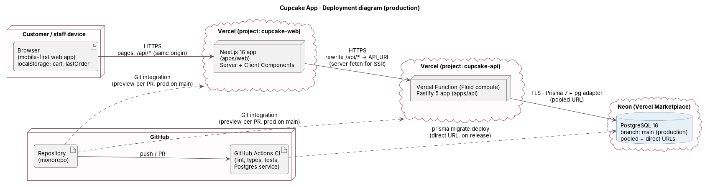
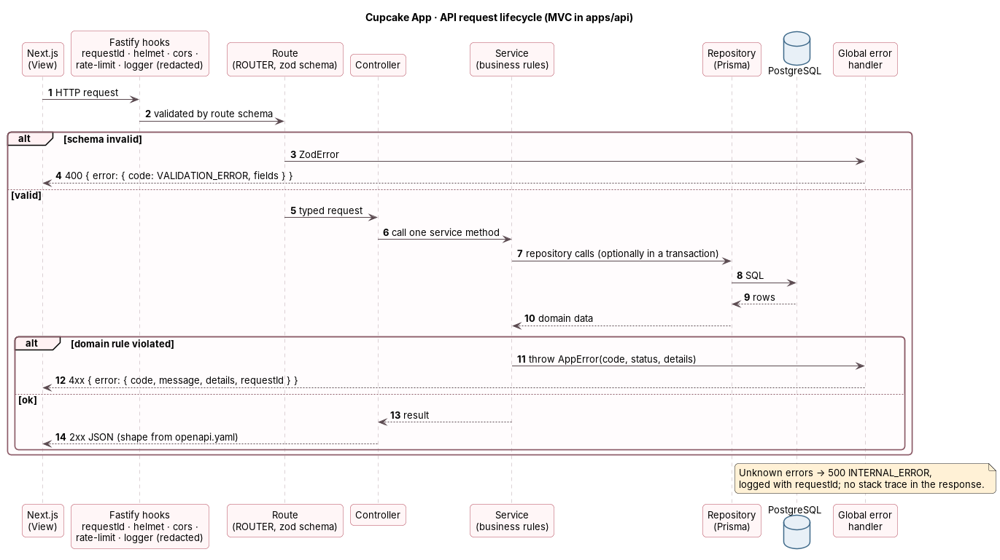

# 02 · Architecture

| | |
|---|---|
| **Version** | 1.0 (Phase 4, 11 Oct 2026) |
| **Status** | Draft for approval |
| **Related** | [01-prd.md](01-prd.md) (BR, NFR) · [03-data-model.md](03-data-model.md) · [04-ui-design-system.md](04-ui-design-system.md) · [07-api-spec.md](07-api-spec.md) + [openapi.yaml](openapi.yaml) · [05-testing-strategy.md](05-testing-strategy.md) · [06-development-workflow.md](06-development-workflow.md) |

This document defines how the system is built: the MVC layering the course requires, the monorepo, the technology versions, the error model, security, configuration, environments and hosting. It is the reference for every implementation task.

---

## 1. Architectural drivers

| Driver | Source | Consequence |
|---|---|---|
| MVC structure, explainable to graders | Course (S-II), D-10 | Fastify API split into routes → controllers → services → repositories; Next.js is the View |
| Correct stock under concurrency | BR-05, BR-11, NFR-08 | Order creation in one PostgreSQL transaction with conditional stock decrement |
| Mobile-first, fast catalog | NFR-01, NFR-02 | Server-rendered catalog, optimized images, small client bundle |
| Spec-driven, AI-implemented | Overview §1, CLAUDE.md | Contract first (`openapi.yaml`), shared validation schemas, strict TypeScript, tests per BR |
| Privacy | BR-16, NFR-06 | No phone in responses or logs; first name only |
| Low cost, low ops, deadline 17 Nov | D-14, R-02, R-04 | Managed hosting with Git deploys and preview environments; no servers to maintain |

## 2. System context and containers



| Container | Technology | Responsibility |
|---|---|---|
| **Web** (`apps/web`) | Next.js 16 (App Router), React, Tailwind CSS v4, shadcn/ui | **View**: pages SCR-01…SCR-05, cart and latest-order storage in the browser, formatting, calls the API |
| **API** (`apps/api`) | Node.js 24 LTS, Fastify 5, Zod | **Controller + Model**: HTTP contract, validation, business rules BR-01…BR-19, persistence |
| **Database** | PostgreSQL 16 (Neon) | Catalog, customers, orders; constraints from `physical-model.sql` |
| **Database package** (`packages/database`) | Prisma ORM 7 | Schema, migrations, seed, generated client |
| **Shared package** (`packages/shared`) | TypeScript + Zod | Validation schemas (BR-14), error codes, store configuration, phone utilities, shared types |

The browser talks only to the Web origin. The Web app proxies `/api/*` to the API (Next.js rewrite), so the browser never needs CORS and the API URL isn't exposed in client code.

## 3. MVC mapping

| MVC role | Where | Rules |
|---|---|---|
| **View** | `apps/web` pages and components | Renders data and collects input. No business rules: it never computes prices, totals or stock decisions that the server must confirm. It may apply UX limits (stepper max) that the server re-validates. |
| **Router** | `apps/api/src/routes/*.routes.ts` | Declares method, path and Zod schemas (params, query, body, response). Nothing else. |
| **Controller** | `apps/api/src/controllers/*.controller.ts` | Receives the typed request, calls **one** service method, maps the result to the HTTP response (status, body). No business logic, no Prisma. |
| **Model: services** | `apps/api/src/services/*.service.ts` | Business rules (BR-xx), transactions, domain errors (`AppError` with a stable code). Plain TypeScript plus repository calls. |
| **Model: repositories** | `apps/api/src/repositories/*.repository.ts` | Prisma queries only. No HTTP knowledge, no business decisions. |

Request flow and error path: 

Logical packages: [package diagram](diagrams/class-diagram/package-diagram.svg).

## 4. Technology stack and versions

Versions are the current stable lines on 11 Oct 2026. Pin exact versions in `package.json` (no `^` on frameworks) and upgrade only on purpose.

| Concern | Choice | Version line | Notes |
|---|---|---|---|
| Runtime | Node.js | 24 LTS | Same version locally (`.nvmrc`), in CI and on Vercel |
| Package manager / monorepo | pnpm workspaces | 10.x | No Turborepo: four packages don't need it |
| Language | TypeScript | 5.9 | `strict`, `noUncheckedIndexedAccess` |
| Web framework | Next.js (App Router) | 16.x | Server Components for data pages, Client Components for interactive parts |
| UI | Tailwind CSS v4 + shadcn/ui (Base UI primitives) + lucide-react + Sonner | latest stable | Theme only in `globals.css` (UI doc §4) |
| Client state | Zustand with `persist` | 5.x | Cart store; `lastOrderStore` is a tiny typed wrapper over `localStorage` |
| API framework | Fastify | 5.x | With `@fastify/helmet`, `@fastify/cors`, `@fastify/rate-limit`, `fastify-type-provider-zod` |
| Validation | Zod | 4.x | Shared schemas in `packages/shared` |
| ORM | Prisma ORM | 7.x (`@prisma/client` 7) | `prisma-client` generator, `@prisma/adapter-pg`, `prisma.config.ts`. **Not Prisma 8**: still a release candidate and lacks atomic `increment`/`decrement` and nested writes, which order creation uses. |
| Database | PostgreSQL | 16 | Neon in the cloud; Docker `postgres:16` locally and in CI |
| API client (web) | `openapi-typescript` + `openapi-fetch` | latest stable | Types generated from `docs/openapi.yaml` |
| Tests | Vitest, Testing Library, Playwright, `@axe-core/playwright` | latest stable | See `05-testing-strategy.md` |
| Lint / format | ESLint 9 (flat config) + typescript-eslint, Prettier | latest stable | Enforced in CI |
| Hosting | Vercel (web and API), Neon (database, through the Vercel Marketplace) | n/a | §10 |

## 5. Repository layout

```
cupcake-app/
├─ apps/
│  ├─ web/                          # Next.js · VIEW
│  │  ├─ src/app/
│  │  │  ├─ layout.tsx              # font, Toaster, header/footer shells
│  │  │  ├─ globals.css             # copy of docs/design/theme/globals.css
│  │  │  ├─ page.tsx                # SCR-01 Catálogo (?filter=)
│  │  │  ├─ cart/page.tsx           # SCR-02
│  │  │  ├─ checkout/page.tsx       # SCR-03
│  │  │  ├─ orders/[code]/page.tsx  # SCR-04 Meu pedido (?new=1)
│  │  │  ├─ not-found.tsx · error.tsx   # SCR-05
│  │  ├─ src/components/ui/         # shadcn/ui primitives (unmodified)
│  │  ├─ src/components/            # AppHeader, LatestOrderCard, FilterChips, ProductCard, CartLine, OrderSummary, …
│  │  ├─ src/lib/api/               # openapi-fetch client + generated schema.d.ts
│  │  ├─ src/lib/                   # cart-store.ts, last-order-store.ts, format.ts
│  │  ├─ public/images/products/    # six photos from docs/design/assets/photos
│  │  └─ next.config.ts             # rewrites /api/* → API_URL, security headers, images
│  └─ api/                          # Fastify · ROUTER + CONTROLLER + MODEL
│     └─ src/
│        ├─ index.ts                # Vercel entry: buildApp() + listen
│        ├─ app.ts                  # buildApp(): plugins, routes, error handler (used by tests)
│        ├─ config.ts               # env parsing with Zod (fails fast)
│        ├─ plugins/                # prisma, security (helmet, cors, rate-limit), request-id
│        ├─ routes/                 # health, catalog, products, orders
│        ├─ controllers/            # catalog, orders
│        ├─ services/               # catalog, order, stock, order-code
│        ├─ repositories/           # category, tag, product, customer, order
│        └─ errors/                 # AppError, error codes, global handler
├─ packages/
│  ├─ database/                     # Prisma schema, migrations (incl. raw CHECK constraints), seed.ts, prisma.config.ts
│  └─ shared/                       # zod schemas, error codes, store config, phone utils, types
├─ docs/                            # this documentation (spec, design, diagrams)
├─ e2e/                             # Playwright tests (journey, visual, a11y)
├─ docker-compose.yml               # postgres:16 for local dev and integration tests
├─ .github/workflows/ci.yml
├─ CLAUDE.md · README.md · .nvmrc · pnpm-workspace.yaml · tsconfig.base.json · eslint.config.js
```

Dependency rule: `web → shared`, `api → shared, database`, `database → (none)`, `shared → (none)`. The web app never imports `database`.

## 6. Key design decisions

### 6.1 Order creation (BR-10, BR-11, BR-15, BR-19)

`OrderService.create(input)` runs in **one interactive Prisma transaction** (default READ COMMITTED isolation):

1. Load the requested active products by id; missing or inactive → `PRODUCT_NOT_FOUND` (409).
2. For each line, ordered by product id (avoids deadlocks): `updateMany({ where: { id, stockQuantity: { gte: q } }, data: { stockQuantity: { decrement: q } } })`. Any `count = 0` → read current stock and throw `INSUFFICIENT_STOCK` (409) with `{ productId, requested, available }[]`; the transaction rolls back.
3. Upsert the customer by normalized phone (name updated).
4. Compute line totals and total from **database prices**; insert order (AWAITING_PICKUP) and items with `unitPriceCents`.
5. On a unique violation of `orders.code` (Prisma `P2002`), retry the **whole** transaction with a new code, up to 5 times.

The conditional `UPDATE … WHERE stock_quantity >= q` is atomic in PostgreSQL, so two concurrent orders for the last units can't both succeed (US-15 AC4). Sequence: [SD-02](diagrams/sequence-diagrams/sd-02-place-order.svg).

### 6.2 Derived values

| Value | Computed by | Rule |
|---|---|---|
| `stockState` (`AVAILABLE`, `LOW`, `SOLD_OUT`) | CatalogService | LOW when 1–5 (A-02) |
| `readyAt` | OrderService | `createdAt + STORE.readyMinutes` (BR-12) |
| `customerFirstName` | OrderService | First word of the stored name (BR-16) |
| "Order from today" | Web (`last-order-store.ts`) | Same calendar date in `America/Sao_Paulo` (BR-19) |

### 6.3 Store configuration (single place)

`packages/shared/src/store.ts` exports `STORE = { name, address, openingHours, readyMinutes: 15, timeZone: "America/Sao_Paulo" }`. The web uses it for the footer, checkout and Meu pedido; the API uses `readyMinutes`. Values are the placeholders of A-03.

### 6.4 Rendering strategy (web)

| Page | Rendering | Data |
|---|---|---|
| `/` Catálogo | Server Component fetches filters and products (`cache: "no-store"`, stock changes) and passes them to client islands (cards with steppers, chips, latest-order card) | `GET /api/catalog/filters`, `GET /api/products` |
| `/cart` | Client Component | Cart store + `GET /api/products` refresh |
| `/checkout` | Client Component | Cart store, `POST /api/orders` |
| `/orders/[code]` | Server Component fetch + client islands (success notice for `?new=1`, copy button) | `GET /api/orders/{code}` |

Filter changes use `router.replace("/?filter=…", { scroll: false })` and re-render on the server; products are few (6), so no client cache library is needed.

### 6.5 Images

Photos are static files in `apps/web/public/images/products/<slug>.jpg`; `Product.imageUrl` stores `/images/products/<slug>.jpg`. Rendered with `next/image` (`sizes="(min-width:1024px) 33vw, 50vw"`).

## 7. Error model (NFR-07)

Every error response has the same shape (OpenAPI `ErrorResponse`):

```json
{
  "error": {
    "code": "INSUFFICIENT_STOCK",
    "message": "Not enough stock for one or more items.",
    "details": { "items": [{ "productId": "…", "requested": 2, "available": 1 }] },
    "requestId": "8f2c1b6e-…"
  }
}
```

- `code` is stable and listed below; the UI maps it to pt-BR copy (UI doc §9.5). `message` is English, for developers; the UI never displays it.
- `details` is optional and code-specific (`fields` for validation, `items` for stock, `productIds` for missing products).
- One global error handler: `AppError` → its status/code; Zod validation → `VALIDATION_ERROR`; rate-limit → `RATE_LIMITED`; anything else → `INTERNAL_ERROR` (logged with stack, never returned).

| Code | HTTP | When |
|---|---|---|
| `VALIDATION_ERROR` | 400 | Body or query fails the schema (BR-14, BR-06) |
| `ORDER_NOT_FOUND` | 404 | Unknown or malformed order code |
| `NOT_FOUND` | 404 | Unknown route |
| `PRODUCT_NOT_FOUND` | 409 | An ordered product doesn't exist or is inactive |
| `INSUFFICIENT_STOCK` | 409 | Stock can't cover one or more lines (BR-05, BR-11) |
| `RATE_LIMITED` | 429 | Too many requests (NFR-05) |
| `INTERNAL_ERROR` | 500 | Unexpected failure |

The list lives in `packages/shared/src/error-codes.ts` and in `openapi.yaml`; both must match (contract test).

## 8. Security and privacy (NFR-05, NFR-06)

| Measure | Implementation |
|---|---|
| Input validation | Zod schemas on every route (params, query, body); unknown body properties rejected |
| Server authority | Prices, totals and stock computed on the server only (BR-07, BR-11) |
| Rate limiting | `@fastify/rate-limit`: `POST /api/orders` 10/min per IP; other routes 120/min. In-memory per function instance (acceptable for the MVP; Vercel Firewall rules can add a global limit). Client IP from `x-forwarded-for` (`trustProxy: true`). |
| CORS | `@fastify/cors` allows only `WEB_ORIGIN` (the browser normally uses the same-origin rewrite) |
| Security headers | `@fastify/helmet` on the API; `next.config.ts` headers on the web (CSP with `self` + Google Fonts not needed when using `next/font`, `X-Content-Type-Options`, `Referrer-Policy`, `Permissions-Policy`) |
| HTTPS | Vercel terminates TLS; DB connections use TLS (`sslmode=require`) |
| Secrets | Only in Vercel/GitHub environment variables; `.env*` git-ignored; `.env.example` documents names |
| Logging | Fastify pino logger with `redact: ["req.body.customer.phone", "req.body.customer.name", "*.phone"]`; request id in every log line and in the `x-request-id` response header; no request bodies logged at info level |
| Public data | Order responses expose first name only, never phone or internal ids of customers/orders (BR-16) |
| Enumeration | Order codes have 31⁶ possibilities and are non-sequential (BR-13); malformed codes return the same 404 as unknown codes |
| Dependencies | `pnpm audit --prod` in CI (warning level) |

## 9. Configuration

Environment variables, parsed and validated at startup (`config.ts` with Zod); the process exits with a clear message if one is missing.

| Variable | App | Example | Purpose |
|---|---|---|---|
| `DATABASE_URL` | api, database | `postgresql://…-pooler…/cupcake?sslmode=require` | Runtime connection (Neon **pooled**) |
| `DIRECT_URL` | database | `postgresql://…/cupcake?sslmode=require` | Migrations (Neon **direct**) |
| `WEB_ORIGIN` | api | `https://cupcake-web.vercel.app` | CORS allow-list |
| `LOG_LEVEL` | api | `info` | Logger level |
| `API_URL` | web (server only) | `https://cupcake-api.vercel.app` | Target of the `/api/*` rewrite and of server-side fetches |
| `NEXT_PUBLIC_SITE_URL` | web | `https://cupcake-web.vercel.app` | Absolute URLs (metadata) |

Business constants (ready minutes, store info, low-stock threshold, line cap 20) are code constants in `packages/shared`, not environment variables.

## 10. Environments and hosting

| Environment | Web | API | Database | Trigger |
|---|---|---|---|---|
| Local | `pnpm dev` (Next.js :3000) | `pnpm dev` (Fastify :4000) | Docker `postgres:16` (`cupcake_dev`) | Developer |
| Test / CI | n/a (Playwright starts both apps) | Fastify `inject` + started server | Docker/CI service `postgres:16` (`cupcake_test`) | Every push and PR |
| Preview | Vercel preview deployment | Vercel preview deployment | Neon branch `preview` (shared by previews) | Every PR |
| Production | Vercel `cupcake-web` | Vercel `cupcake-api` | Neon `main` branch | Merge to `main` |

**Why Vercel + Neon:** both apps deploy from Git with preview environments and instant rollback; Fastify runs on Vercel with zero configuration as a single function using Fluid compute (fewer cold starts, R-04); Neon is managed PostgreSQL 16 with branching and a free tier, provisioned through the Vercel Marketplace. Nothing to patch or keep running. Two Vercel projects point at the same repository with root directories `apps/web` and `apps/api`.

**Migrations:** never run on application start. `prisma migrate deploy` runs as a release step (`06-development-workflow.md` §5) against `DIRECT_URL`, before the production deployment is promoted.

**Health:** `GET /api/health` checks the API and a `SELECT 1`; used before user-testing sessions and recordings (R-04).

## 11. Quality attributes → tactics

| NFR | Tactic |
|---|---|
| NFR-01 Responsiveness | Mobile-first Tailwind, `overflow-x-hidden`, visual checks at 390/1280 (CLAUDE.md §6a) |
| NFR-02 Performance | Server-rendered catalog, `next/image`, 6 small photos, no client data library, API in the same Vercel region as Neon (`gru1` São Paulo if available for both, otherwise `iad1` for both) |
| NFR-03 Accessibility | shadcn/Base UI accessible primitives, labels, `aria-*` from UI doc §8.5, axe checks in E2E |
| NFR-04 Localization | `Intl` pt-BR formatters in `apps/web/src/lib/format.ts`, times in America/Sao_Paulo |
| NFR-05 Security | §8 |
| NFR-07 Errors | §7 + UI error map |
| NFR-08 Integrity | Transaction §6.1 + DB constraints (03-data-model §6) |
| NFR-09 Maintainability | Layering §3, dependency rule §5, lint/format, strict TS |
| NFR-10 Testability | `buildApp()` for injection tests, real PostgreSQL in CI (`05-testing-strategy.md`) |
| NFR-12 Payment clarity | Copy from UI doc; test that no payment UI exists (T-14-1) |

## 12. Risks and open points

| ID | Item | Mitigation |
|---|---|---|
| AR-1 | In-memory rate limiting is per instance on serverless | Acceptable for the MVP; add a Vercel Firewall rate-limit rule if abuse appears |
| AR-2 | Neon free tier suspends idle compute (cold connection ~1 s) | Warm up with `/api/health` before tests and recordings (R-04) |
| AR-3 | Prisma 7 driver-adapter setup on Vercel | Walking skeleton deploys the API with one DB query on day 1 (24 Oct milestone) |
| AR-4 | Back end not on the course's suggested language list (R-01) | Plain, layered TypeScript; this document explains the MVC mapping |

## 13. Change log

| Version | Date | Change |
|---|---|---|
| 1.0 | 11 Oct 2026 | Initial architecture: MVC mapping, monorepo, stack versions, order transaction, error model, security, configuration, environments, Vercel + Neon hosting |
