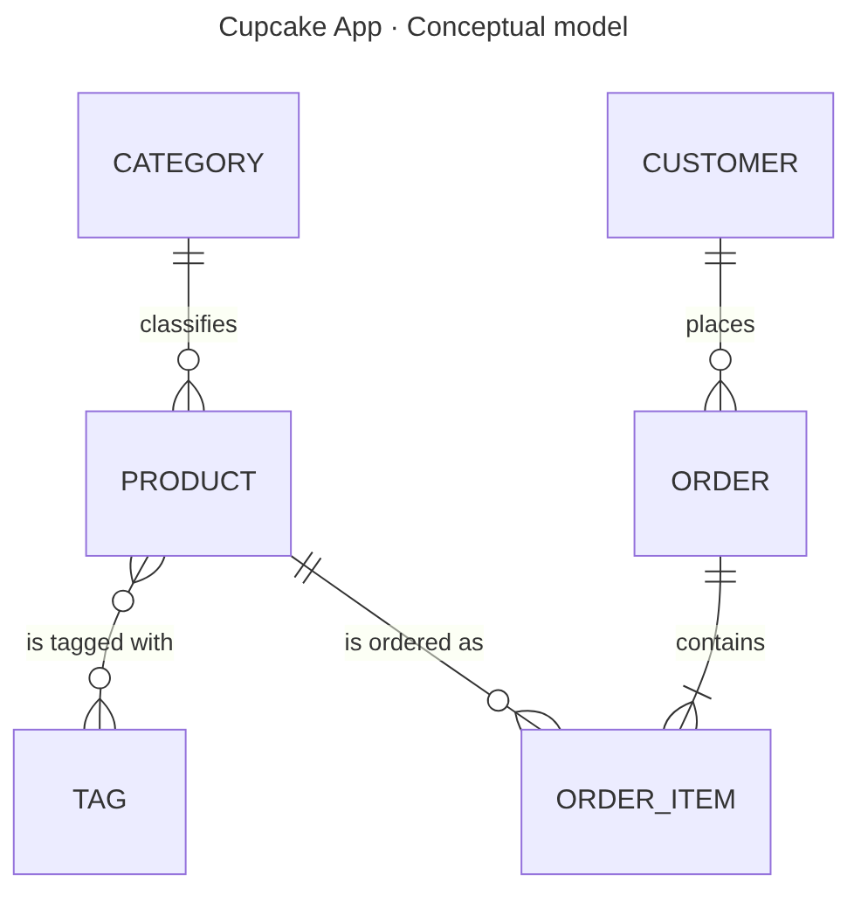
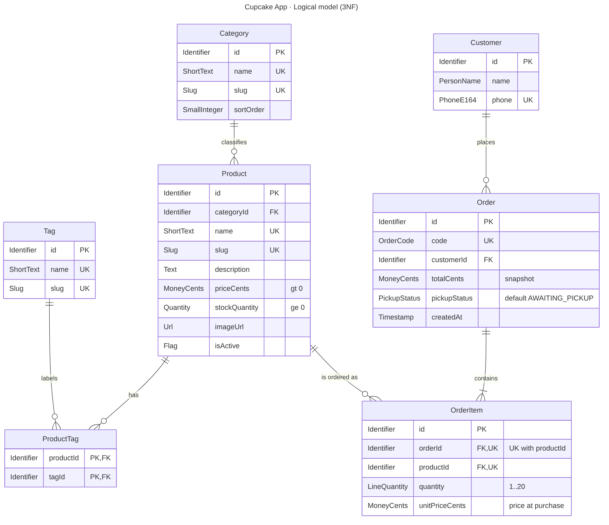
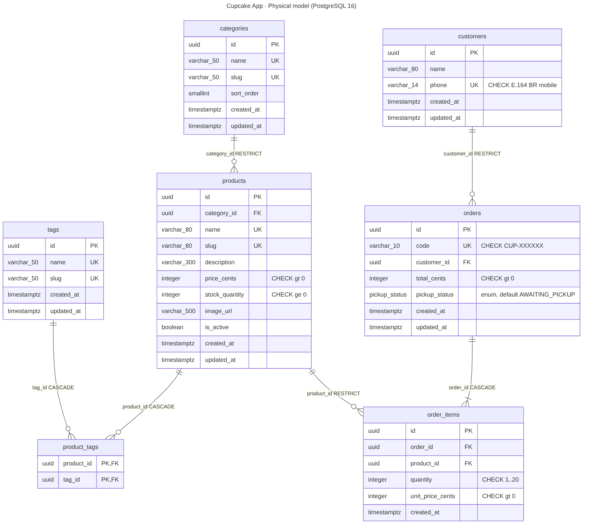

# 03 · Data Model

| | |
|---|---|
| **Version** | 1.1 (Phase 3, 11 Oct 2026) |
| **Status** | Updated for the approved UI (pay at the store, six-product seed) |
| **DBMS** | PostgreSQL 16 |
| **Physical source of truth** | [`diagrams/database/physical-model.sql`](diagrams/database/physical-model.sql) |
| **Related** | [01-prd.md](01-prd.md) (BR-xx), [class diagram](diagrams/class-diagram/class-diagram.svg) |

This document covers PIT II Situação 1 data requirements: the **conceptual design** and the **normalized logical design** derived from the persistence class diagram, plus the **physical design** with its **data dictionary** (S-II p.31).

---

## 1. Modeling approach

```
Persistence class diagram ──▶ Conceptual model ──▶ Logical model (3NF) ──▶ Physical model (PostgreSQL)
(UML, domain view)            (entities +           (attributes, domains,    (tables, types, constraints,
                               relationships)         keys, normalization)     indexes, DDL)
```

| Artifact | File |
|---|---|
| Persistence class diagram | [`diagrams/class-diagram/class-diagram.svg`](diagrams/class-diagram/class-diagram.svg) |
| Conceptual ER diagram | [`diagrams/database/er-conceptual.svg`](diagrams/database/er-conceptual.svg) |
| Logical ER diagram | [`diagrams/database/er-logical.svg`](diagrams/database/er-logical.svg) |
| Physical ER diagram | [`diagrams/database/er-physical.svg`](diagrams/database/er-physical.svg) |
| DDL | [`diagrams/database/physical-model.sql`](diagrams/database/physical-model.sql) |

**Naming:** entities and attributes are `PascalCase` / `camelCase` in the class diagram, logical model and code. Tables and columns are `snake_case`, with plural table names (`Order.pickupStatus` → `orders.pickup_status`).

---

## 2. Conceptual model



### Entities

| Entity | Meaning |
|---|---|
| **Category** | A type of cupcake used to organize the catalog: Classics, Chocolate, Fruity (BR-02) |
| **Tag** | A characteristic that cuts across categories, e.g. Bestseller (BR-03) |
| **Product** | A standalone cupcake for sale, with price and stock (BR-01, BR-04) |
| **Customer** | A guest identified by name and phone number; no account (BR-14, BR-15) |
| **Order** | A purchase by a customer, identified publicly by its order code (BR-10, BR-13) |
| **OrderItem** | One line of an order: a product, a quantity, and its unit price at purchase time (BR-07) |

### Relationships

| Relationship | Cardinality | Rule |
|---|---|---|
| Category **classifies** Product | 1 : 0..N | Every product has exactly one category (BR-02) |
| Product **is tagged with** Tag | 0..N : 0..N | Many-to-many, resolved by `ProductTag` in the logical model (BR-03) |
| Customer **places** Order | 1 : 0..N | A reused customer accumulates orders (BR-15) |
| Order **contains** OrderItem | 1 : 1..N | Composition: items exist only inside their order; an order has at least one item |
| Product **is ordered as** OrderItem | 1 : 0..N | A product can appear in many order lines, at most once per order |

---

## 3. Logical model



### 3.1 Domains

A domain is the set of valid values of an attribute, which is more than its data type.

| Domain | Definition | Used by |
|---|---|---|
| `Identifier` | Universally unique identifier (UUID v4), system-generated | All `id`, all FKs |
| `ShortText` | Text, 2–50 characters after trimming | Category.name, Tag.name |
| `Slug` | Lowercase ASCII words separated by single hyphens: `^[a-z0-9]+(-[a-z0-9]+)*$` | Category.slug, Tag.slug, Product.slug |
| `ProductName` | Text, 2–80 characters after trimming | Product.name |
| `Description` | Text, 10–300 characters after trimming (pt-BR) | Product.description |
| `MoneyCents` | Integer > 0, Brazilian centavos (R$ 12,90 = 1290) | Product.priceCents, OrderItem.unitPriceCents, Order.totalCents |
| `StockQuantity` | Integer ≥ 0 | Product.stockQuantity |
| `LineQuantity` | Integer 1–20 (BR-06) | OrderItem.quantity |
| `Url` | Relative or absolute URL, ≤ 500 characters | Product.imageUrl |
| `Flag` | Boolean | Product.isActive |
| `PersonName` | Text, 2–80 characters after trimming (BR-14) | Customer.name |
| `PhoneE164` | Brazilian mobile in E.164: `^\+55[1-9]{2}9[0-9]{8}$` (BR-14) | Customer.phone |
| `OrderCode` | `^CUP-[23456789ABCDEFGHJKMNPQRSTUVWXYZ]{6}$`: 31-symbol alphabet without 0/O/1/I/L (BR-13) | Order.code |
| `PickupStatus` | {AWAITING_PICKUP, PICKED_UP} | Order.pickupStatus |
| `Timestamp` | Instant with time zone | createdAt, updatedAt |
| `SortOrder` | Small integer, default 0 | Category.sortOrder |

### 3.2 Relations (relational schema)

Notation: <u>primary key</u>, *foreign key* → referenced relation.

- **Category** (<u>id</u>, name ᵁᴷ, slug ᵁᴷ, sortOrder, createdAt, updatedAt)
- **Tag** (<u>id</u>, name ᵁᴷ, slug ᵁᴷ, createdAt, updatedAt)
- **Product** (<u>id</u>, *categoryId* → Category, name ᵁᴷ, slug ᵁᴷ, description, priceCents, stockQuantity, imageUrl, isActive, createdAt, updatedAt)
- **ProductTag** (<u>*productId* → Product, *tagId* → Tag</u>)
- **Customer** (<u>id</u>, name, phone ᵁᴷ, createdAt, updatedAt)
- **Order** (<u>id</u>, code ᵁᴷ, *customerId* → Customer, totalCents, pickupStatus, createdAt, updatedAt)
- **OrderItem** (<u>id</u>, *orderId* → Order, *productId* → Product, quantity, unitPriceCents, createdAt), with UK (orderId, productId)

**Candidate keys:** besides the surrogate `id`, the natural keys are Category.slug and .name, Tag.slug and .name, Product.slug and .name, Customer.phone, Order.code, and OrderItem (orderId, productId). Surrogate UUIDs are used as primary keys so that natural keys (e.g. a renamed product) can change without cascading updates, and so internal IDs reveal nothing about volume.

### 3.3 Integrity rules

| Rule | Business source |
|---|---|
| A product's stock is never negative | BR-04, BR-11 |
| Prices and unit prices are positive | BR-07 |
| A line's quantity is 1–20; a product appears at most once per order | BR-06 |
| A new order starts as AWAITING_PICKUP; payment is not recorded (it happens at the counter) | BR-09, BR-10 |
| Stock is decremented in the same transaction that creates the order | BR-11 |
| Order codes are unique and follow the code format | BR-13 |
| Phone numbers are unique and normalized | BR-14, BR-15 |
| Categories can't be deleted while products use them; products can't be deleted once ordered | Referential integrity / order history |

---

## 4. Normalization

The model was derived by normalizing the information on a typical **order slip** (the document a store would fill in by hand).

### 4.1 Unnormalized form (UNF)

```
ORDER_SLIP ( orderCode, orderDate, pickupStatus,
             customerName, customerPhone,
             { productName, productSlug, categoryName, {tagName}, currentPrice, stock,
               quantity, unitPricePaid },
             orderTotal )
```

Problems: a repeating group of lines `{…}`, a nested multi-valued attribute `{tagName}`, customer data repeated on every slip, and product data repeated on every line of every slip.

### 4.2 First normal form (1NF): atomic values, no repeating groups

The repeating group of lines moves to its own relation. Multi-valued tags become one row per (product, tag).

```
ORDER       ( orderCode, orderDate, pickupStatus,
              customerName, customerPhone, orderTotal )
ORDER_LINE  ( orderCode, productSlug, productName, categoryName, currentPrice, stock,
              quantity, unitPricePaid )
PRODUCT_TAG ( productSlug, tagName )
```

### 4.3 Second normal form (2NF): no partial dependencies on a composite key

In `ORDER_LINE`, the key is (orderCode, productSlug). The attributes `productName`, `categoryName`, `currentPrice` and `stock` depend only on `productSlug` (a partial dependency), so they move to `PRODUCT`. `quantity` and `unitPricePaid` depend on the full key and stay.

```
ORDER       ( orderCode, orderDate, pickupStatus,
              customerName, customerPhone, orderTotal )
ORDER_ITEM  ( orderCode, productSlug, quantity, unitPricePaid )
PRODUCT     ( productSlug, productName, categoryName, currentPrice, stock )
PRODUCT_TAG ( productSlug, tagName )
```

### 4.4 Third normal form (3NF): no transitive dependencies

- In `ORDER`: orderCode → customerPhone → customerName. The customer's name depends on the customer, not on the order, so **Customer** (phone, name) is extracted and `ORDER` keeps a reference.
- In `PRODUCT`: productSlug → categoryName. A category has its own identity and could gain attributes such as display order, so **Category** is extracted.
- In `PRODUCT_TAG`: the tag name becomes **Tag** with its own identity and slug, and `PRODUCT_TAG` holds only references.
- Surrogate `id` keys are introduced for every entity. Natural keys (slug, phone, code) remain as UNIQUE candidate keys.

Result: **Category, Tag, Product, ProductTag, Customer, Order, OrderItem** (§3.2). In every relation, each non-key attribute depends on the key, the whole key, and nothing but the key.

**BCNF check:** the only non-trivial functional dependencies are from candidate keys (id, slug/name, phone, code, (orderId, productId)), so every relation is also in Boyce–Codd normal form.

## 5. Deliberate redundancy and derived data

| Item | Decision | Justification |
|---|---|---|
| `OrderItem.unitPriceCents` | **Stored** | It isn't redundant with `Product.priceCents`. It records a **historical fact** (the price paid), which must not change when the catalog price changes (BR-07). |
| `Order.totalCents` | **Stored (controlled denormalization)** | Derivable as Σ(quantity × unitPriceCents). It's stored as an immutable snapshot computed by the server in the same transaction that creates the items, never updated afterward, so it can't drift. It simplifies reads and documents the amount the customer is asked to pay at the counter ("Total a pagar na loja"). Integration tests assert total = Σ lines. |
| Ready time (`readyAt`) | **Derived, not stored** | `createdAt + 15 min` (BR-12, configurable `PICKUP_READY_MINUTES`). Shown as "pronto às HH:mm". |
| "Order from today" | **Derived** | `createdAt` falls on the current date in America/Sao_Paulo. Used by the home latest-order card (BR-19). |
| Customer first name | **Derived** | First word of `Customer.name`, computed for public views (BR-16) |
| Line total | **Derived** | quantity × unitPriceCents |
| Customer name on reuse | **Overwritten** with the latest name (BR-15) | Keeps 3NF (one name per customer). Consequence: older orders display the customer's current first name. That's acceptable because pickup verification relies on the order code and items (BR-18). |

---

## 6. Physical model (PostgreSQL 16)



### 6.1 Physical design decisions

| Decision | Choice | Reason |
|---|---|---|
| Primary keys | `uuid DEFAULT gen_random_uuid()` | Non-guessable, no sequence leakage; built into PostgreSQL 13+ |
| Money | `integer` cents | Exact arithmetic; no floating-point rounding (BR-07) |
| Time | `timestamptz` | Unambiguous instants; displayed in America/Sao_Paulo by the UI (NFR-04) |
| Status field | Native `ENUM` type `pickup_status` | Domain enforced by the database; maps to a Prisma enum. There is no payment status: payment happens at the counter (BR-09). |
| Text lengths | `varchar(n)` matching domain maximums, plus `CHECK` on trimmed minimum length | Domain enforcement in the database, not only in the application (NFR-08) |
| Formats | `CHECK` with regular expressions for slug, phone and order code | Last line of defense if application validation is bypassed |
| FK actions | `RESTRICT` on categories→products, customers→orders, products→order_items; `CASCADE` on orders→order_items and product/tag→product_tags | Order history can't be orphaned; join rows and items die with their owner |
| Indexes | PK and UNIQUE indexes (automatic), plus `products(category_id)`, `product_tags(tag_id)`, `orders(customer_id)`, `order_items(product_id)` | Supports filters, joins and FK checks. `order_items(order_id)` is covered by the composite UNIQUE. |
| `updated_at` | Default `now()`; updated by the application (Prisma `@updatedAt`) | Avoids triggers; keeps behavior visible in code |
| Concurrency | Order creation decrements stock with conditional `UPDATE … WHERE stock_quantity >= $q`, in product-id order, inside the creation transaction | Prevents overselling and avoids deadlocks (BR-11, SD-02) |
| Order code collisions | Unique violation (SQLSTATE 23505) → the whole creation transaction is retried with a new code, up to 5 times | 31⁶ ≈ 887 million codes makes collisions rare. PostgreSQL aborts a transaction after an error, so the retry wraps the entire transaction. |

### 6.2 Constraint-to-rule map

| Constraint | Table | Rule |
|---|---|---|
| `products_stock_nonneg` | products | BR-04 |
| `products_price_pos`, `order_items_unit_price_pos` | products, order_items | BR-07 |
| `order_items_quantity_range` | order_items | BR-06 |
| `order_items_order_product_key` | order_items | One line per product per order |
| `customers_phone_fmt`, `customers_name_len` | customers | BR-14 |
| `customers_phone_key` | customers | BR-15 |
| `orders_code_fmt`, `orders_code_key` | orders | BR-13 |
| `orders_total_pos` | orders | Orders have at least one priced line |

The full DDL is in [`diagrams/database/physical-model.sql`](diagrams/database/physical-model.sql).

---

## 7. Data dictionary

Legend: **PK** primary key · **FK** foreign key · **UK** unique · **NN** not null · **CK** check constraint.

### 7.1 `categories`: product categories (BR-02)

| Column | Type | Null | Default | Keys / constraints | Domain | Description |
|---|---|---|---|---|---|---|
| id | uuid | NN | gen_random_uuid() | PK | Identifier | Surrogate identifier |
| name | varchar(50) | NN | none | UK; CK 2–50 trimmed | ShortText | Display name shown in the UI (pt-BR), e.g. "Clássicos" |
| slug | varchar(50) | NN | none | UK; CK slug format | Slug | Stable English identifier used in URLs and filters, e.g. `classics` |
| sort_order | smallint | NN | 0 | none | SortOrder | Position of the category chip in the catalog |
| created_at | timestamptz | NN | now() | none | Timestamp | Creation instant |
| updated_at | timestamptz | NN | now() | none | Timestamp | Last update instant (set by the application) |

### 7.2 `tags`: cross-category product characteristics (BR-03)

| Column | Type | Null | Default | Keys / constraints | Domain | Description |
|---|---|---|---|---|---|---|
| id | uuid | NN | gen_random_uuid() | PK | Identifier | Surrogate identifier |
| name | varchar(50) | NN | none | UK; CK 2–50 trimmed | ShortText | Display name (pt-BR), e.g. "Mais vendido" |
| slug | varchar(50) | NN | none | UK; CK slug format | Slug | Stable identifier, e.g. `bestseller` |
| created_at | timestamptz | NN | now() | none | Timestamp | Creation instant |
| updated_at | timestamptz | NN | now() | none | Timestamp | Last update instant |

### 7.3 `products`: cupcakes for sale (BR-01, BR-04, BR-07)

| Column | Type | Null | Default | Keys / constraints | Domain | Description |
|---|---|---|---|---|---|---|
| id | uuid | NN | gen_random_uuid() | PK | Identifier | Surrogate identifier |
| category_id | uuid | NN | none | FK → categories.id (RESTRICT); indexed | Identifier | The product's single category |
| name | varchar(80) | NN | none | UK; CK 2–80 trimmed | ProductName | Product name as displayed, e.g. "Chocolate Crush" |
| slug | varchar(80) | NN | none | UK; CK slug format | Slug | Stable identifier, e.g. `chocolate-crush` |
| description | varchar(300) | NN | none | CK 10–300 trimmed | Description | Short pt-BR description shown on the card |
| price_cents | integer | NN | none | CK > 0 | MoneyCents | Current unit price in centavos |
| stock_quantity | integer | NN | 0 | CK ≥ 0 | StockQuantity | Units available. Decremented when an order is created (BR-11). |
| image_url | varchar(500) | NN | none | none | Url | Product image path or URL |
| is_active | boolean | NN | true | none | Flag | Inactive products are hidden and can't be ordered (BR-04) |
| created_at | timestamptz | NN | now() | none | Timestamp | Creation instant |
| updated_at | timestamptz | NN | now() | none | Timestamp | Last update instant |

### 7.4 `product_tags`: product ↔ tag association (BR-03)

| Column | Type | Null | Default | Keys / constraints | Domain | Description |
|---|---|---|---|---|---|---|
| product_id | uuid | NN | none | PK (with tag_id); FK → products.id (CASCADE) | Identifier | Tagged product |
| tag_id | uuid | NN | none | PK (with product_id); FK → tags.id (CASCADE); indexed | Identifier | Applied tag |

### 7.5 `customers`: guest customers (BR-14, BR-15, BR-16)

| Column | Type | Null | Default | Keys / constraints | Domain | Description |
|---|---|---|---|---|---|---|
| id | uuid | NN | gen_random_uuid() | PK | Identifier | Surrogate identifier |
| name | varchar(80) | NN | none | CK 2–80 trimmed | PersonName | Full name as last provided at checkout. Only the first name is ever shown publicly. |
| phone | varchar(14) | NN | none | UK; CK `^\+55[1-9]{2}9[0-9]{8}$` | PhoneE164 | Normalized mobile number. Used only to reuse the record; never returned publicly or logged (BR-16, NFR-06). |
| created_at | timestamptz | NN | now() | none | Timestamp | First order instant |
| updated_at | timestamptz | NN | now() | none | Timestamp | Last update (e.g. name changed on reuse) |

### 7.6 `orders`: customer orders (BR-10…BR-13, BR-18)

| Column | Type | Null | Default | Keys / constraints | Domain | Description |
|---|---|---|---|---|---|---|
| id | uuid | NN | gen_random_uuid() | PK | Identifier | Internal identifier, never exposed |
| code | varchar(10) | NN | none | UK; CK `^CUP-[23456789ABCDEFGHJKMNPQRSTUVWXYZ]{6}$` | OrderCode | Public order code presented at pickup |
| customer_id | uuid | NN | none | FK → customers.id (RESTRICT); indexed | Identifier | Customer who placed the order |
| total_cents | integer | NN | none | CK > 0 | MoneyCents | Snapshot of Σ(quantity × unit_price_cents), set at creation (§5) |
| pickup_status | pickup_status | NN | 'AWAITING_PICKUP' | enum | PickupStatus | AWAITING_PICKUP on creation → PICKED_UP (future, outside MVP) |
| created_at | timestamptz | NN | now() | none | Timestamp | Order creation. Basis of the ready time (+15 min, BR-12) and of the "today" rule (BR-19). |
| updated_at | timestamptz | NN | now() | none | Timestamp | Last status change |

### 7.7 `order_items`: order lines (BR-06, BR-07)

| Column | Type | Null | Default | Keys / constraints | Domain | Description |
|---|---|---|---|---|---|---|
| id | uuid | NN | gen_random_uuid() | PK | Identifier | Surrogate identifier |
| order_id | uuid | NN | none | FK → orders.id (CASCADE); UK (order_id, product_id) | Identifier | Owning order |
| product_id | uuid | NN | none | FK → products.id (RESTRICT); indexed | Identifier | Ordered product |
| quantity | integer | NN | none | CK 1–20 | LineQuantity | Units ordered |
| unit_price_cents | integer | NN | none | CK > 0 | MoneyCents | Product price at the moment the order was created |
| created_at | timestamptz | NN | now() | none | Timestamp | Creation instant |

### 7.8 Enumerated types

| Type | Values | Meaning |
|---|---|---|
| `pickup_status` | `AWAITING_PICKUP` | Order placed and stock reserved; waiting for the customer, who pays at the counter |
| | `PICKED_UP` | Handed over. Reserved for future use; not set by the MVP (BR-18). |

---

## 8. Seed catalog (US-21)

Category and tag **names** are UI text (pt-BR); **slugs** are English identifiers used in code and URLs. Product names are kept as defined by the product owner. Descriptions are the short pt-BR descriptors shown on the product card. Images are the approved product photos in [`design/assets/photos/`](design/assets/photos/), served by the web app at `/images/products/<slug>.jpg`.

### Categories and tags

| Type | name (UI) | slug | sort_order |
|---|---|---|---|
| Category | Clássicos | `classics` | 1 |
| Category | Chocolate | `chocolate` | 2 |
| Category | Frutados | `fruity` | 3 |
| Tag | Mais vendido | `bestseller` | n/a |

UI filter chips map to: **Todos** (all) · **Mais vendidos** (tag `bestseller`) · **Clássicos** · **Chocolate** · **Frutados**. Chip labels are final copy in [`04-ui-design-system.md`](04-ui-design-system.md).

### Products

| # | Name | slug | Category | Bestseller | Price | Stock | UI state covered | Description (pt-BR) | Photo |
|---|---|---|---|---|---|---|---|---|---|
| 1 | Birthday Vanilla | `birthday-vanilla` | classics | ✔ | R$ 9,90 | 40 | available | Baunilha · confeitos | `birthday-vanilla.jpg` |
| 2 | Red Velvet Classic | `red-velvet-classic` | classics | | R$ 12,90 | 25 | available | Cacau · cream cheese | `red-velvet-classic.jpg` |
| 3 | Chocolate Crush | `chocolate-crush` | chocolate | ✔ | R$ 11,90 | 35 | available | Chocolate · ganache | `chocolate-crush.jpg` |
| 4 | Cookies & Cream | `cookies-and-cream` | chocolate | | R$ 12,90 | 3 | **low stock** ("Restam 3") | Biscoito · creme | `cookies-and-cream.jpg` |
| 5 | Strawberry Kiss | `strawberry-kiss` | fruity | ✔ | R$ 11,90 | 30 | available | Morango · creme rosa | `strawberry-kiss.jpg` |
| 6 | Lemon Cream | `lemon-cream` | fruity | | R$ 11,90 | 0 | **sold out** ("Esgotado") | Limão siciliano · creme | `lemon-cream.jpg` |

Catalog display order is the table order (it matches the approved catalog screen). This covers US-21 AC3: one bestseller per category, a low-stock product (#4) and a sold-out product (#6). The seed script must be **idempotent** (upsert by slug) and must not reset stock in production once real test orders exist. The seed policy is defined in Phase 4 (`06-development-workflow.md`).

> v1.0 listed 12 illustrated products. They were replaced by the six photographed products of the approved UI (Phase 3).

---

## 9. Validation evidence

The v1.1 DDL and seed were run against **PostgreSQL 16.15** on 11 Oct 2026 (script: [`diagrams/database/validation-checks.sql`](diagrams/database/validation-checks.sql)):

- The DDL applied without errors; the 6 products, 3 categories and 1 tag loaded with 3 bestsellers (Birthday Vanilla, Chocolate Crush, Strawberry Kiss).
- The order-creation transaction decremented stock and inserted the order as AWAITING_PICKUP (Chocolate Crush 35 → 33, Birthday Vanilla 40 → 39; total R$ 33,70).
- The customer upsert by phone updated the name (BR-15).
- A conditional decrement with insufficient stock (5 × Cookies & Cream, stock 3) affected 0 rows.
- **14 invalid operations were all rejected** by the intended constraint:

| # | Invalid operation | Rejected by |
|---|---|---|
| 1 | Phone not in E.164 (`11912345678`) | customers_phone_fmt |
| 2 | Landline-style number (`+5511812345678`) | customers_phone_fmt |
| 3 | Name with 1 character | customers_name_len |
| 4 | Negative stock | products_stock_nonneg |
| 5 | Zero price | products_price_pos |
| 6 | Duplicate order code | orders_code_key |
| 7 | Order code with ambiguous characters | orders_code_fmt |
| 8 | Order total 0 | orders_total_pos |
| 9 | Removed status value `NOT_READY` | pickup_status enum |
| 10 | Line quantity 21 | order_items_quantity_range |
| 11 | Same product twice in one order | order_items_order_product_key |
| 12 | Delete a category in use | products_category_fk (RESTRICT) |
| 13 | Delete an ordered product | order_items_product_fk (RESTRICT) |
| 14 | Slug with spaces and capitals | categories_slug_fmt |

These checks become automated integration tests in Phase 5 (NFR-08, NFR-10).

## 10. Notes for Phase 4 (Prisma mapping)

- Models `Category`, `Tag`, `Product`, `ProductTag`, `Customer`, `Order`, `OrderItem` use `@@map("<table>")` and `@map("<column>")` for snake_case names; enum `PickupStatus` uses `@@map`.
- `@default(dbgenerated("gen_random_uuid()")) @db.Uuid` for IDs; `@db.VarChar(n)`, `@db.SmallInt`, `@db.Timestamptz` to match types; `@updatedAt` for `updatedAt`.
- Prisma doesn't express `CHECK` constraints: add them in a raw SQL migration copied from `physical-model.sql`, and verify with a schema-diff test that the migrated database matches this document.
- The conditional stock decrement uses `updateMany({ where: { id, stockQuantity: { gte: q } }, data: { stockQuantity: { decrement: q } } })` and checks `count`. It runs inside the interactive transaction that creates the order; if any `count` is 0 the transaction is rolled back.

## 11. Change log

| Version | Date | Change |
|---|---|---|
| 1.0 | 10 Oct 2026 | Initial conceptual, logical (3NF/BCNF) and physical models; data dictionary; seed catalog; validation evidence |
| 1.1 | 11 Oct 2026 | Approved UI: payment at the store (removed `payment_status`, `paid_at` and their CHECKs; `pickup_status` = AWAITING_PICKUP \| PICKED_UP); stock decremented at order creation; derived ready time (+15 min) and "today" rule; six-product photographed seed; re-validated on PostgreSQL 16 |
