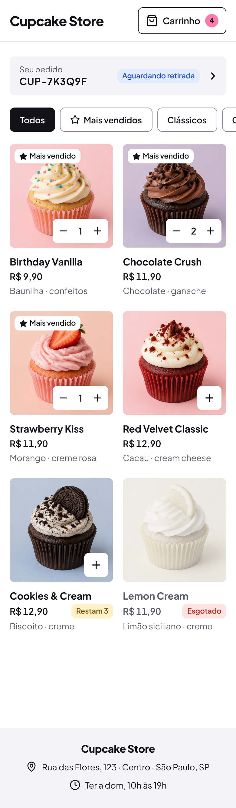
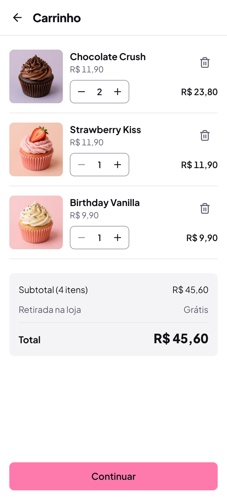
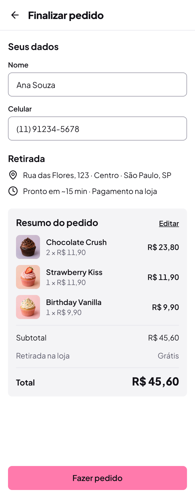
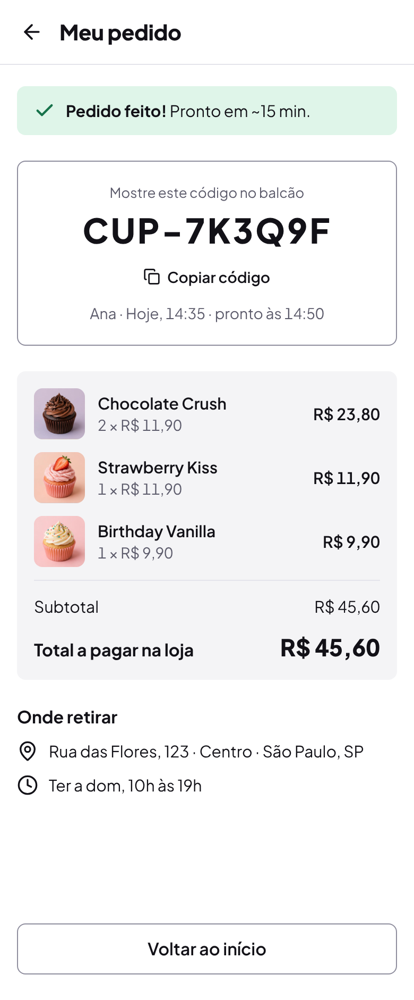
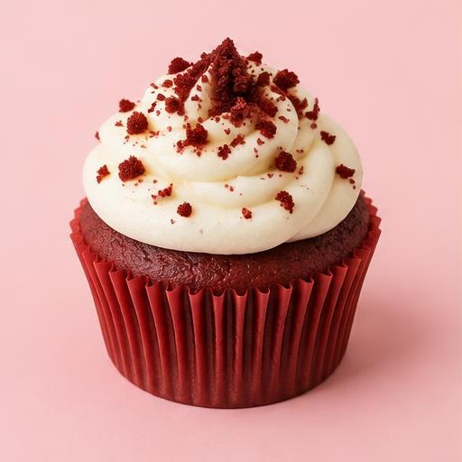
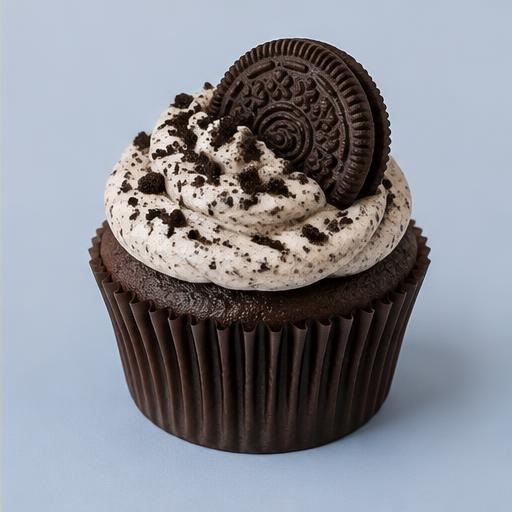

# 04 · UI Design System and Screen Specification

| | |
|---|---|
| **Version** | 1.2 (Phase 3, 11 Oct 2026) |
| **Status** | **Approved** by the product owner on 11 Oct 2026 |
| **Design source** | Claude Design canvas "Cupcake Store Screens" and design system "Cupcake Store" (exported into [`design/`](design/)) |
| **Related** | [01-prd.md](01-prd.md) (BR, US, SCR IDs) · [03-data-model.md](03-data-model.md) (seed) · [diagrams/user-flows/](diagrams/user-flows/) |

This document is the single source of truth for **how the app looks and behaves on screen**: the theme (standard Tailwind CSS v4 + shadcn/ui, configured in one `globals.css`), components, the nine approved screens, states, routes and the exact pt-BR copy. The PRD says *what* the product does; this document says *how it appears*.

> **Language policy:** this document is in English. Every string in quotes or in the copy deck (§9) is **final UI text in pt-BR** and must be used verbatim.

---

## 1. How to use this document (read this before building any screen)

The approved UI is attached to the repository in three forms. Use them together:

| Form | Path | Use it for |
|---|---|---|
| **Screenshots** (2×) | [`design/screenshots/*.png`](design/screenshots/) | The visual target. Compare your page against it at the same width (390 px mobile, 1280 px desktop). |
| **Reference HTML** | [`design/screens/*.html`](design/screens/) | Structure, order and strings of each screen, written with inline pixel values. Open a file in a browser to click through. Translate values to Tailwind steps with §4. |
| **Theme** | [`design/theme/globals.css`](design/theme/globals.css) | The whole design system in one file: shadcn/ui CSS variables (colors), radius, font, flat elevation. Copy to `apps/web/src/app/globals.css`. |
| **Assets** | [`design/assets/photos/`](design/assets/photos/) (6 product photos, 512 × 512 JPG) · [`design/assets/icons/`](design/assets/icons/) (Lucide SVGs) | Copy the photos to `apps/web/public/images/products/<slug>.jpg`. Use `lucide-react` for icons (same names). |

### Rules for implementation

1. **Reproduce, don't reinterpret.** Layout, spacing, sizes, colors, typography, radius and copy must match the reference. Don't add sections, headings, icons, shadows, borders, helper texts or features that aren't in the reference.
2. **The reference HTML is a static mockup.** Product names, prices, counts, the customer name, times and the order code are **sample data**. In the app they come from the API, the cart store and `lastOrderStore`. Screen sizes (`width: 390px`, fixed heights) are artboard sizes, not layout rules: pages are fluid (§5).
3. **Rebuild with shadcn/ui components and standard Tailwind utilities** (§4, §6). Never paste `style="…"` blocks into React and never use arbitrary values copied from the reference (`text-[15px]`, `bg-[#f4f4f6]`).
4. **Everything visual comes from `globals.css`.** No hex values, fonts, radii or shadows in components, and no new component variants. The radius is **8px everywhere** (all shadcn radius steps map to it); `rounded-full` only for the cart count badge and the success check circle. The **toast** is the only element with a shadow.
5. **Copy is final.** Use the strings in §9 exactly (accents, middle dots `·`, ellipsis `…`, non-breaking currency format `R$ 11,90`).
6. **When the reference and this document disagree,** this document wins (theme mapping, behavior, states, routes); the reference wins for structure and copy. Known gaps are listed in §11. If something is missing in both, ask (CLAUDE.md §3).

---

## 2. Design principles (approved direction)

- **Preply-inspired, flat and clean.** White pages, ink text, one pink accent, generous whitespace. No brutalist outlines, no heavy borders, no button shadows.
- **Real photography sells.** Square product photos with 8px corners; no illustrations or cartoon graphics anywhere.
- **Typography-led brand.** The logo is the words "Cupcake Store" in Plus Jakarta Sans 800, with no icon.
- **One short line per message.** Copy is minimal and direct (§9).
- **Mobile first, no horizontal overflow.** Designed at 390 px, must work from 360 px to 1440 px (NFR-01). The only horizontal scroll is the filter chip row, with its scrollbar hidden.
- **Pickup and pay at the store.** No online payment UI of any kind (BR-09). The total is always labeled for the counter.

---

## 3. Screen inventory

| Ref | Screen | PRD screen | Route | Width | Screenshot |
|---|---|---|---|---|---|
| 01 | Catálogo (Todos) + latest-order card | SCR-01 | `/` | 390 | [01-catalog.png](design/screenshots/01-catalog.png) |
| 02 | Catálogo filtrado (Chocolate) + toast + stock limit | SCR-01 | `/?filter=chocolate` | 390 | [02-catalog-filtered.png](design/screenshots/02-catalog-filtered.png) |
| 03 | Carrinho | SCR-02 | `/cart` | 390 | [03-cart.png](design/screenshots/03-cart.png) |
| 04 | Finalizar pedido | SCR-03 | `/checkout` | 390 | [04-checkout.png](design/screenshots/04-checkout.png) |
| 05 | Meu pedido (just placed) | SCR-04 | `/orders/CUP-7K3Q9F?new=1` | 390 | [05-my-order.png](design/screenshots/05-my-order.png) |
| 06 | Finalizar pedido · erros e enviando | SCR-03 | `/checkout` | 390 | [06-checkout-errors.png](design/screenshots/06-checkout-errors.png) |
| 07 | Estados: carregando, falha, vazio, remover item, sem pedido, não encontrado | SCR-01/02/05 | n/a | 1280 board | [07-states.png](design/screenshots/07-states.png) |
| 08 | Catálogo (desktop) | SCR-01 | `/` | 1280 | [08-desktop-catalog.png](design/screenshots/08-desktop-catalog.png) |
| 09 | Finalizar pedido (desktop) | SCR-03 | `/checkout` | 1280 | [09-desktop-checkout.png](design/screenshots/09-desktop-checkout.png) |

Flow and navigation: [user flow](diagrams/user-flows/user-flow.svg) · [navigation map](diagrams/user-flows/navigation-map.svg) · [conceptual map](diagrams/user-flows/conceptual-map.svg).

<table>
<tr>
<td></td>
<td></td>
<td></td>
<td></td>
</tr>
<tr><td>01 Catálogo</td><td>03 Carrinho</td><td>04 Finalizar pedido</td><td>05 Meu pedido</td></tr>
</table>

---

## 4. Theme: standard Tailwind CSS v4 + shadcn/ui

The design system is **not a custom token set**. It is the standard shadcn/ui theme, configured in one file: [`design/theme/globals.css`](design/theme/globals.css) (copy to `apps/web/src/app/globals.css`).

**Rules**

1. **All design decisions live in `globals.css`**: colors (shadcn CSS variables), the radius, the font, and the "flat" elevation. To change the look, edit a variable there; never restyle components one by one.
2. **Use shadcn/ui components with their standard variants and sizes** (`Button` `default | secondary | outline | ghost | link | destructive`, sizes `default | sm | lg | icon`; `Badge`; `Input`; `Label`; `Card`; `Alert`; `Skeleton`; `Separator`; `ToggleGroup`; `Sonner`). **Don't add variants** to `button.tsx`, `badge.tsx` or any other component, and don't create a parallel component library.
3. **Use Tailwind's default scales**: spacing (`gap-3`, `p-4`, `h-12` …), type (`text-sm` … `text-4xl`), weights, tracking and the default color palette for the few status colors that shadcn doesn't define (§4.3). No `@theme` extensions beyond what `globals.css` contains, no arbitrary values such as `text-[15px]` or `bg-[#f4f4f6]`. The single allowed arbitrary property is `[scrollbar-width:none]` on the filter row (§6.3).
4. Layout tweaks on a component instance (`className="h-12 w-full"`) are fine; they use standard utilities and don't create variants.

> **Fidelity note:** the reference screens were drawn with pixel values (15px, 22px, 13px …). The implementation uses the nearest Tailwind step (tables below). Differences of 1–2 px in type size, and the slightly different status tints of the Tailwind palette, are **expected and accepted**. Layout, structure, colors of the main surfaces, radius and copy must still match.

### 4.1 Colors (shadcn variables in `globals.css`)

| Variable → utility | Value | Use in this app |
|---|---|---|
| `--background` → `bg-background` | `#ffffff` | Pages, cards |
| `--foreground` → `text-foreground`, `bg-foreground` | `#121117` | Text and icons; selected filter chip; toast; cart button border |
| `--primary` / `--primary-foreground` → `bg-primary text-primary-foreground` | `#ff7aac` / `#121117` | `Button variant="default"` (all main CTAs); cart count badge. Pink is never text. |
| `--secondary` / `--secondary-foreground` | `#f4f4f6` / `#121117` | `bg-secondary` panels: latest-order card, order summaries, totals box, footer |
| `--muted` / `--muted-foreground` | `#f4f4f6` / `#5c5b6b` | `text-muted-foreground`: descriptors, unit prices, meta lines; `bg-muted`: skeletons, sold-out photo backdrop |
| `--accent` / `--accent-foreground` | `#ffe8f1` / `#121117` | Hover of `outline` and `ghost` buttons (shadcn default behavior) |
| `--destructive` → `text-destructive`, `bg-destructive/10`, `border-destructive` | `#b42318` | Field errors, stock errors, "Esgotado" |
| `--border` → `border` (default color) | `#e4e4eb` | Dividers (`border-b`, `Separator`), header bottom line |
| `--input` → `border-input` | `#8f8e9e` | `Input`, outline buttons, filter chips, cart stepper, Meu pedido code card |
| `--ring` | `#2b5ce6` | shadcn focus ring (`focus-visible:ring-ring/50 ring-[3px]`, standard) |

### 4.2 Radius and elevation (in `globals.css`)

| Decision | How it's implemented |
|---|---|
| **8px everywhere** | `--radius: 0.5rem` and `--radius-sm/md/lg/xl` all mapped to `var(--radius)`, so every shadcn component (`rounded-md`, `rounded-lg` …) renders 8px. In markup prefer `rounded-lg`. |
| Round shapes | Only `rounded-full` for the cart count badge and the success check circle. |
| **Flat UI, no button shadows** | `--shadow-2xs/xs/sm/md` and `--shadow` set to none, so shadcn's built-in `shadow-xs`/`shadow-sm` disappear globally. |
| Toast elevation | `shadow-lg` (unchanged Tailwind default, used by Sonner) is the only shadow. |

### 4.3 Status colors (Tailwind default palette)

shadcn has no success/warning/info tokens, so these use plain Tailwind palette classes. Use exactly these pairs:

| Status | Background | Text / icon | Used by |
|---|---|---|---|
| Success | `bg-emerald-50` | `text-emerald-700` | "Pedido feito!" notice |
| Warning | `bg-amber-100` | `text-amber-800` | "Restam N", "Máximo disponível.", stock-adjusted notice |
| Info | `bg-blue-100` | `text-blue-700` | "Aguardando retirada" badge |
| Error | `bg-destructive/10` | `text-destructive` | Stock error notice, "Esgotado" |

### 4.4 Typography (Tailwind scale)

Font: **Plus Jakarta Sans** via `next/font/google` (`Plus_Jakarta_Sans`, weights 400–800, `variable: "--font-plus-jakarta-sans"`); `globals.css` maps it to `font-sans`. Use `tabular-nums` on every price, quantity, time and order code.

| Role | Classes | Reference px |
|---|---|---|
| Wordmark (mobile) | `text-xl font-extrabold tracking-tight` | 22 |
| Wordmark (desktop) | `text-2xl font-extrabold tracking-tight` | 24 |
| Page title in inner header | `text-xl font-extrabold tracking-tight` | 20 |
| Desktop page title | `text-4xl font-extrabold tracking-tight` | 40 |
| Section heading | `text-lg font-bold` | 18 |
| Small section heading ("Onde retirar") | `text-base font-bold` | 16 |
| Product name (card, cart line) | `text-base font-bold` | 16 |
| Product name (summary line) | `text-sm font-semibold` | 15 |
| Price, line total | `text-sm font-semibold tabular-nums` | 15 |
| Total value | `text-2xl font-extrabold tabular-nums` | 22 |
| Order code (Meu pedido) | `text-3xl font-extrabold tracking-wider tabular-nums` | 32 |
| Order code (home card) | `text-base font-bold tracking-wide tabular-nums` | 16 |
| Body, inputs | `text-base` | 16 |
| Descriptor, meta, labels | `text-sm` (`font-semibold` for labels and chips) | 14 |
| Small meta ("Seu pedido", "Mostre este código…", "Máximo disponível.") | `text-xs` | 13 |
| Badge | `text-xs font-semibold` (shadcn `Badge`) | 12 |

### 4.5 Spacing and sizes (Tailwind scale)

| Reference px | Utility step | Typical use |
|---|---|---|
| 4 · 6 · 8 | `1` · `1.5` · `2` | Badge gaps, label → input, chip gap, icon → text |
| 10 · 12 · 14 | `2.5` · `3` · `3.5` | Info rows, gaps inside rows and cards, form field gap |
| 16 · 20 · 24 | `4` · `5` · `6` | Mobile gutter (`px-4`), panel padding, section gap (`gap-6`) |
| 32 · 40 · 48 · 64 | `8` · `10` · `12` · `16` | Section spacing, desktop grid gaps, desktop padding |
| Control heights 40 · 44 · 48 | `h-10` · `h-11` / `size-11` · `h-12` | Chips and steppers · icon buttons and cart button · inputs and CTAs |
| Photos 48 · 56 · 92 · 64 | `size-12` · `size-14` · `size-23` · `size-16` | Summary line · desktop summary line · cart line · empty-state tile |

Borders are always 1px (`border`, `border-b`, `border-t`).

---

## 5. Layout and responsive rules

| Context | Classes / rule |
|---|---|
| Mobile (default) | Full width, gutter `px-4`. Product grid `grid grid-cols-2 gap-x-4 gap-y-6`. Sticky bottom action bar on cart and checkout. |
| Desktop (`lg:` ≥ 1024 px) | Container `mx-auto w-full max-w-6xl px-6` (1152 px, the closest standard step to the reference 1120). Header inner row uses the same container. |
| Catalog grid (desktop) | `sm:grid-cols-2 lg:grid-cols-3 gap-x-6 gap-y-10` (the reference's auto-fill 280 px gives 3 columns at desktop width). |
| Checkout (desktop) | `lg:grid lg:grid-cols-5 lg:items-start lg:gap-12`: form column `lg:col-span-3`, summary aside `lg:col-span-2` (`rounded-lg bg-secondary p-6`, contains the CTA). |
| Overflow | `overflow-x-hidden` on `html, body` (in `globals.css`) and `min-w-0` on flex/grid children. No element may exceed the viewport (NFR-01). |
| Touch targets | ≥ 44 × 44 px (`size-11` icon buttons; 40 px chips and steppers keep at least 44 px of hit area including gaps; NFR-03). |
| Sticky action bar | `sticky bottom-0 bg-background px-4 pt-3 pb-5`, no border, no shadow; holds one `Button size="lg" className="h-12 w-full"`. |

---

## 6. Components (shadcn/ui + standard utilities)

Each component names the shadcn primitive, the variant and the utility classes to use. App-level components live in `apps/web/src/components/`; shadcn primitives in `components/ui/` stay **unmodified** (as generated by the shadcn CLI).

### 6.1 AppHeader

| Variant | Build |
|---|---|
| Catalog (mobile) | `<header className="flex items-center justify-between gap-3 border-b px-4 py-3">`: wordmark `<Link>` (§4.4) · cart `Button variant="outline" size="lg" className="h-11 border-foreground px-3"` with `ShoppingBag` icon, label "Carrinho" and, when count > 0, `<span className="rounded-full bg-primary px-1.5 text-xs font-bold tabular-nums">`. `aria-label="Carrinho, N itens"`. |
| Inner page (mobile) | `border-b py-2 pl-2 pr-4 flex items-center gap-1`: `Button variant="ghost" size="icon" className="size-11"` with `ArrowLeft` · `<h1>` page title (§4.4). |
| Desktop | Same as catalog, inside the desktop container, `py-4`. Desktop checkout shows `Button variant="ghost"` "Continuar comprando" with `ArrowLeft` instead of the cart. |

No history or account icon in the header.

### 6.2 LatestOrderCard (home)

`<Link>` styled as a panel: `flex items-center gap-3 rounded-lg bg-secondary py-3 pl-4 pr-3` (`lg:max-w-md`).
Left: `text-xs text-muted-foreground` "Seu pedido" over the code (§4.4). Right: `Badge variant="secondary" className="bg-blue-100 text-blue-700"` "Aguardando retirada" and `ChevronRight` (`size-5`). `aria-label="Seu pedido CUP-XXXXXX, aguardando retirada"`. Hidden unless BR-19 passes (§8.3); no skeleton.

### 6.3 FilterChips

`ToggleGroup type="single"` (or links with `Button`) inside `<div className="-mx-4 flex gap-2 overflow-x-auto px-4 [scrollbar-width:none] lg:mx-0 lg:flex-wrap lg:px-0">`.
- Each chip: `Button variant="outline" className="h-10 shrink-0 border-input px-4 font-semibold"`; "Mais vendidos" has a `Star` icon (`size-4`).
- Selected chip: same button plus `bg-foreground text-background hover:bg-foreground/90`, `aria-pressed="true"`.
- Updates `?filter=`; **no heading** repeats the selected filter.

### 6.4 ProductCard

```
<article className="flex min-w-0 flex-col gap-3">
  <div className="relative aspect-square overflow-hidden rounded-lg bg-muted">
    <Image … className="object-cover" />
    <Badge variant="secondary" className="absolute left-2 top-2 bg-background">★ Mais vendido</Badge>
    <!-- add button or stepper at absolute right-2 bottom-2 -->
  </div>
  <div className="flex flex-col gap-0.5">
    <h2 className="text-base font-bold">Birthday Vanilla</h2>
    <span className="text-sm font-semibold tabular-nums">R$ 9,90</span>
    <p className="text-sm text-muted-foreground">Baunilha · confeitos</p>
  </div>
</article>
```

- **Add button** (not in cart): `Button variant="secondary" size="icon" className="size-10 bg-background"` with `Plus`; `aria-label="Adicionar {nome}"`.
- **Card stepper** (in cart): `div.flex.h-10.items-center.rounded-lg.bg-background` with two `Button variant="ghost" size="icon"` (`Minus`, `Plus`) and the quantity (`min-w-5 text-center text-sm font-semibold tabular-nums`). Minus at 1 removes from the cart (US-05 AC3). Plus `disabled` at the limit, and `<p role="status" className="text-xs text-amber-800">Máximo disponível.</p>` appears under the card.
- **Low stock (1–5):** `Badge` with `bg-amber-100 text-amber-800` "Restam N" at the right of the price row.
- **Sold out:** image `opacity-50 grayscale`, name and price `text-muted-foreground`, `Badge variant="destructive"`-style tint `bg-destructive/10 text-destructive` "Esgotado", no add control.

### 6.5 QuantityStepper (cart)

`div.inline-flex.h-10.items-center.rounded-lg.border.border-input` with `Button variant="ghost" size="icon"` × 2 and the value (`min-w-6 text-center text-sm font-semibold tabular-nums`). Minus `disabled` at 1; removal uses the trash button.

### 6.6 CartLine

`flex gap-3` with the photo (`size-23 rounded-lg object-cover`, spans both rows) and a `flex-1 min-w-0` column holding two rows: name + unit price (`text-sm text-muted-foreground`) with the trash `Button variant="ghost" size="icon" className="size-11 text-muted-foreground"` on the right; then the stepper with the line total (`text-sm font-semibold tabular-nums`) on the right. Row padding `py-4`, divider `border-b`.
Remove confirmation: inline `div.rounded-lg.border.p-4` with "Remover {nome}?" and `Button` (default) "Remover" + `Button variant="outline"` "Cancelar".

### 6.7 Buttons (shadcn `Button`, no new variants)

| Purpose | Variant / size | Instance classes |
|---|---|---|
| Main CTA ("Continuar", "Fazer pedido") | `default` / `lg` | `h-12 w-full` |
| Secondary ("Voltar ao início", "Cancelar") | `outline` / `lg` | `h-12 w-full border-input` |
| Small action in a notice ("Revisar") | `outline` / `sm` | `border-input bg-background` |
| Text actions ("Copiar código") | `ghost` / `sm` | with `Copy` icon |
| Inline link ("Editar") | plain `<Link className="text-sm font-semibold underline underline-offset-4">` | `variant="link"` would be pink text (not allowed) |
| Icon buttons (back, trash) | `ghost` / `icon` | `size-11` |
| Loading | `default` + `disabled` | `Loader2` with `animate-spin` + "Enviando…" (shadcn disabled style = 50% opacity) |

### 6.8 TextField

shadcn `Label` + `Input` in `flex flex-col gap-1.5`; `Input className="h-12 text-base"` (16px avoids iOS zoom). Error: `aria-invalid="true"` (shadcn styles it with `border-destructive`), message `<p className="text-sm font-medium text-destructive">`. Placeholders: "Ex.: Maria Silva", "(11) 91234-5678". Phone: `inputMode="tel"`, `autoComplete="tel-national"`, `tabular-nums`.

### 6.9 OrderSummary

`<section className="flex flex-col gap-3 rounded-lg bg-secondary p-4">` (desktop aside `p-6`).
- Checkout header: `flex items-baseline justify-between` with "Resumo do pedido" (`text-lg font-bold`) and "Editar" link.
- Line: `flex items-center gap-3`: photo `size-12` (desktop `size-14`) `rounded-lg object-cover` · `flex-1 min-w-0` name (`text-sm font-semibold`) over "{q} × R$ {unit}" (`text-sm text-muted-foreground tabular-nums`) · line total (`text-sm font-semibold tabular-nums`).
- `Separator` · "Subtotal" row (`text-sm`) · "Retirada na loja · Grátis" (`text-sm text-muted-foreground`, checkout only) · `Separator` · total row: label `font-bold` ("Total" / "Total a pagar na loja") and value (§4.4).
- Error variant: the affected line's unit text uses `text-destructive` and appends " · só N disponível".
- The checkout summary is **never removed** (US-13).

### 6.10 PickupInfo / StoreInfo

Rows `flex items-start gap-2.5 text-sm` with Lucide `MapPin` / `Clock` (`size-5 shrink-0`):
- Checkout "Retirada": address · "Pronto em ~15 min · Pagamento na loja".
- Meu pedido "Onde retirar": address · opening hours.
- Footer: `<footer className="mt-auto flex flex-col items-center gap-2.5 bg-secondary px-4 pb-7 pt-6 text-sm">` with the wordmark (`text-base font-extrabold`) and the two rows (`size-4` icons).

Store name, address, hours and ready minutes come from one config module.

### 6.11 OrderCode block (Meu pedido)

`Card`-like container without shadcn `Card` padding defaults: `<section className="flex flex-col items-center gap-1.5 rounded-lg border border-input py-5 text-center">`: "Mostre este código no balcão" (`text-xs text-muted-foreground`) · code (§4.4) · `Button variant="ghost" size="sm"` "Copiar código" · meta "{Nome} · Hoje, {HH:mm} · pronto às {HH:mm}" (`text-sm text-muted-foreground tabular-nums`). On copy: toast "Código copiado".

### 6.12 Notice (shadcn `Alert`)

`Alert` with an icon and one line; tone via palette classes (§4.3), no new `Alert` variants:

| Tone | Build | Example |
|---|---|---|
| Success | `Alert className="border-0 bg-emerald-50"` + `Check` `text-emerald-700` | "**Pedido feito!** Pronto em ~15 min." |
| Warning | `Alert className="border-0 bg-amber-100"` + `CircleAlert` `text-amber-800` | "Cookies & Cream: só 3 disponíveis. Quantidade ajustada." |
| Error | `Alert variant="destructive" className="border-0 bg-destructive/10"` + action `Button variant="outline" size="sm"` | "Chocolate Crush: só 1 disponível." + "Revisar" |

### 6.13 Toast (shadcn `Sonner`)

`<Toaster position="bottom-center" toastOptions={{ classNames: { toast: "bg-foreground text-background border-0" } }} />` (dark toast, `rounded-lg`, Sonner's `shadow-lg`). `toast("Adicionado ao carrinho", { action: { label: "Ver carrinho", onClick } })`. Duration 4 s.

### 6.14 Badge (shadcn `Badge`)

`variant="secondary"` as the base, tinted with the §4.3 pairs; `bg-background` for the bestseller badge on photos. Renders 8px radius automatically (radius tokens).

### 6.15 EmptyState and Skeleton

- **EmptyState:** `flex flex-col items-center gap-3 text-center`: icon tile `size-16 rounded-lg bg-secondary` (or `bg-destructive/10`) with a `size-7` icon · title `text-xl font-bold` · one line `text-muted-foreground` · one `Button`.
- **Skeleton:** shadcn `Skeleton className="bg-muted"` blocks mirroring the real layout (shadcn's default `bg-accent` would be pink).

---

## 7. Screen specifications

Each screen lists structure top to bottom, data bindings and states. Visual values are in §6 and the reference HTML.

### 7.1 SCR-01 · Catálogo (`/`) · refs 01, 02, 08

1. AppHeader (catalog variant) with the live cart count (total units, US-07).
2. `<main className="flex flex-col gap-5 px-4 pb-8 pt-6">`:
   1. **LatestOrderCard** when the BR-19 rule passes (§8.3).
   2. **FilterChips**; `?filter=` values: `bestsellers`, `classics`, `chocolate`, `fruity`; no value = Todos.
   3. **Product grid** of ProductCards in seed order (03-data-model §8).
3. Footer with store info.
4. Toast after adding ("Adicionado ao carrinho" · "Ver carrinho" → `/cart`).

States: loading = skeleton (ref 07 "Catálogo · carregando"); failure = EmptyState "Não foi possível carregar" / "Verifique sua conexão." / "Tentar de novo"; empty filter = EmptyState "Nenhum cupcake aqui" / "Veja todos os sabores." / button "Ver todos"; stock limit = card stepper plus disabled + "Máximo disponível.".

Desktop (ref 08): same order inside the desktop container (`py-12`); latest-order card `lg:max-w-md`; grid `sm:grid-cols-2 lg:grid-cols-3 gap-x-6 gap-y-10`; chips wrap.

### 7.2 SCR-02 · Carrinho (`/cart`) · ref 03

1. Inner header "Carrinho" (back → `/`).
2. `<main className="flex flex-1 flex-col gap-6 px-4 pb-6 pt-2">`: CartLines; totals box (`flex flex-col gap-2.5 rounded-lg bg-secondary p-4`): "Subtotal (N itens)" · "Retirada na loja · Grátis" (`text-muted-foreground`) · `Separator` · "Total" + value (§4.4).
3. Sticky action bar: primary "Continuar" → `/checkout`.

States: empty = EmptyState "Carrinho vazio" / "Escolha seus cupcakes." / "Ver cupcakes" (no action bar); stock refreshed = warning Notice above the lines ("{nome}: só N disponíveis. Quantidade ajustada." or "{nome} esgotou e saiu do carrinho."); remove confirmation (ref 07).

### 7.3 SCR-03 · Finalizar pedido (`/checkout`) · refs 04, 06, 09

1. Inner header "Finalizar pedido" (back → `/cart`).
2. `<main className="flex flex-1 flex-col gap-6 px-4 pb-6 pt-5">`:
   1. Section "Seus dados": TextFields "Nome", "Celular", then the privacy line `<p className="text-xs text-muted-foreground">` (§9.3 `privacy.notice`, NFR-06, A-08).
   2. Section "Retirada": address · "Pronto em ~15 min · Pagamento na loja".
   3. OrderSummary with "Editar".
3. Sticky action bar: primary "Fazer pedido".

Behavior: empty cart → redirect to `/cart`. Validate on blur and submit (BR-14). Submitting: button becomes loading "Enviando…" (ref 06). Success → clear cart, save `lastOrder`, `router.replace('/orders/{code}?new=1')`. Insufficient stock (409) → danger Notice at the top of main "{nome}: só N disponível." with "Revisar" → `/cart`, and the affected summary line in `danger` (ref 06). Field errors → TextField error state with the messages in §9.

Desktop (ref 09): header with wordmark + "Continuar comprando"; title "Finalizar pedido" (`text-4xl font-extrabold tracking-tight`); form fields side by side (`grid grid-cols-2 gap-x-5 gap-y-4`); "Retirada" box `rounded-lg border p-5` showing "Cupcake Store · {endereço}" and "Pronto em ~15 min · {horário} · Pagamento na loja"; summary aside with "Fazer pedido" inside it. No subtitle under the title (removed on both mobile and desktop, G-1).

### 7.4 SCR-04 · Meu pedido (`/orders/{code}`) · ref 05

One page for both "just placed" and "reopened" (BR-19, US-18).

1. Inner header "Meu pedido" (back → `/`).
2. `<main className="flex flex-1 flex-col gap-6 px-4 pb-6 pt-5">`:
   1. Success Notice "**Pedido feito!** Pronto em ~15 min." **only when `?new=1`**; remove the flag from the URL after showing it (so a refresh or the home card shows the reopened version).
   2. Code card: the OrderCode block (§6.11), `rounded-lg border border-input py-5`.
   3. OrderSummary (no header, no "Editar", no pickup row): lines, "Subtotal", "Total a pagar na loja".
   4. "Onde retirar": address and hours.
   5. `Button variant="outline" size="lg" className="mt-auto h-12 w-full border-input"` "Voltar ao início".

Data: `GET /api/orders/{code}` → code, firstName, createdAt, readyAt, items (name, imageUrl, quantity, unitPriceCents, lineTotalCents), totalCents. Times in America/Sao_Paulo; "Hoje" when the order is from today, otherwise `dd/mm`.

States: loading = skeleton of the code card and summary; not found = EmptyState "Pedido não encontrado" / "Confira o código (CUP-XXXXXX)." / outline "Voltar ao início" (ref 07); error = "Não foi possível carregar" + "Tentar de novo".

No status badge on this page (design decision); the status badge appears only on the home card.

### 7.5 SCR-05 · Not found / generic error · ref 07

EmptyState pattern. Unknown routes: "Página não encontrada" / "O link pode estar errado." / "Voltar ao início".

---

## 8. Behavior rules for the UI

### 8.1 Formatting (NFR-04)

- Money: `Intl.NumberFormat('pt-BR', { style: 'currency', currency: 'BRL' })` → `R$ 11,90`. Values are integer cents from the API.
- Quantity × price: `{q} × R$ {unit}` with the multiplication sign `×`.
- Times: `HH:mm` (24 h) in America/Sao_Paulo; dates `dd/mm`.
- Phone input accepts `(11) 91234-5678`, `11912345678`, `+55 11 91234-5678`; mask to `(DD) 9XXXX-XXXX` while typing.

### 8.2 Cart (BR-17)

Stored in `localStorage` key `cupcake.cart` as `[{ productId, quantity }]`. Badge = total units. Refresh against `GET /api/products` when the cart or checkout opens (US-10). Cleared after the order is created.

### 8.3 Latest order (BR-19)

- Key `cupcake.lastOrder` = `{ "code": "CUP-7K3Q9F", "createdAt": "2026-10-11T17:35:00.000Z" }`. Written after a 201 from `POST /api/orders`; overwrites the previous value. Nothing else is stored (no name, phone or items).
- Home card shows only if: stored → `createdAt` is today in America/Sao_Paulo → `GET /api/orders/{code}` returns 200 with `pickupStatus = AWAITING_PICKUP`. 404 → remove the key. Network error → hide silently. See [AD-02](diagrams/activity-diagrams/ad-02-latest-order-card.svg) and [SD-03](diagrams/sequence-diagrams/sd-03-latest-order-card.svg).
- Wrap every `localStorage` access in `try/catch`; if storage is unavailable, the app works without the card.

### 8.4 Ready time (BR-12)

`readyAt = createdAt + 15 min`, computed by the API from `PICKUP_READY_MINUTES` (default 15). The UI never hard-codes the time; "~15 min" in copy reads the same config.

### 8.5 Accessibility (NFR-03)

Every icon-only button has an `aria-label` (§9). Status changes (toast, notices, stock limit) use `role="status"`; blocking errors use `role="alert"`. Chips use `aria-pressed`. Images: product photos have pt-BR `alt` on cards; decorative repeats (cart, summary) use `alt=""` because the name is next to them. Contrast values are in §4.1 (`globals.css` comments).

---

## 9. Copy deck (pt-BR, final)

### 9.1 Global and catalog

| Key | Text |
|---|---|
| brand | Cupcake Store |
| header.cart | Carrinho |
| header.cart.aria | Carrinho, {n} itens |
| filters | Todos · Mais vendidos · Clássicos · Chocolate · Frutados |
| filters.aria | Filtrar cupcakes |
| card.badge.bestseller | Mais vendido |
| card.badge.low | Restam {n} |
| card.badge.soldout | Esgotado |
| card.add.aria | Adicionar {nome} |
| card.stepper.aria | Quantidade de {nome} · Diminuir · Aumentar |
| card.max | Máximo disponível. |
| toast.added | Adicionado ao carrinho · **Ver carrinho** |
| latest.label | Seu pedido |
| latest.status | Aguardando retirada |
| latest.aria | Seu pedido {código}, aguardando retirada |
| footer | Cupcake Store · {endereço} · {horário} |
| catalog.error | Não foi possível carregar · Verifique sua conexão. · Tentar de novo |

### 9.2 Cart

| Key | Text |
|---|---|
| title | Carrinho |
| back.aria | Voltar |
| remove.aria | Remover {nome} |
| remove.confirm | Remover {nome}? · Remover · Cancelar |
| subtotal | Subtotal ({n} itens) |
| pickup | Retirada na loja · Grátis |
| total | Total |
| cta | Continuar |
| empty | Carrinho vazio · Escolha seus cupcakes. · Ver cupcakes |
| adjusted | {nome}: só {n} disponíveis. Quantidade ajustada. |

### 9.3 Checkout

| Key | Text |
|---|---|
| title | Finalizar pedido |
| section.data | Seus dados |
| field.name / placeholder | Nome / Ex.: Maria Silva |
| field.phone / placeholder | Celular / (11) 91234-5678 |
| section.pickup | Retirada |
| pickup.line | Pronto em ~15 min · Pagamento na loja |
| section.summary | Resumo do pedido · Editar |
| cta / loading | Fazer pedido / Enviando… |
| error.name | Informe seu nome. |
| error.phone | Celular inválido. Ex.: (11) 91234-5678 |
| error.stock | {nome}: só {n} disponível. · Revisar |
| desktop.back | Continuar comprando |
| privacy.notice | Usamos seu nome e celular só para preparar e confirmar seu pedido na loja. |

### 9.4 Meu pedido

| Key | Text |
|---|---|
| title | Meu pedido |
| back.aria | Voltar ao início |
| success | **Pedido feito!** Pronto em ~15 min. |
| code.hint | Mostre este código no balcão |
| code.copy | Copiar código |
| meta | {Nome} · Hoje, {HH:mm} · pronto às {HH:mm} |
| subtotal / total | Subtotal / Total a pagar na loja |
| pickup.title | Onde retirar |
| cta | Voltar ao início |
| notfound | Pedido não encontrado · Confira o código (CUP-XXXXXX). · Voltar ao início |

### 9.5 Error-message map (API code → UI)

| API error code (07-api-spec, Phase 4) | Where | Message | Recovery |
|---|---|---|---|
| `VALIDATION_ERROR` (field `name`) | Checkout field | Informe seu nome. | Fix the field |
| `VALIDATION_ERROR` (field `phone`) | Checkout field | Celular inválido. Ex.: (11) 91234-5678 | Fix the field |
| `INSUFFICIENT_STOCK` | Checkout notice + summary line | {nome}: só {n} disponível. | "Revisar" → cart (adjusted) |
| `PRODUCT_NOT_FOUND` | Checkout notice | {nome} não está mais disponível. | "Revisar" → cart (line removed) |
| `ORDER_NOT_FOUND` | Meu pedido | Pedido não encontrado | "Voltar ao início" |
| `RATE_LIMITED` | Checkout notice | Muitas tentativas. Tente de novo em instantes. | Retry later |
| Network / `INTERNAL_ERROR` | Any data screen | Não foi possível carregar · Verifique sua conexão. | "Tentar de novo" |
| Clipboard success | Toast | Código copiado | n/a |

---

## 10. Assets

| Photo | Product (slug) | Category |
|---|---|---|
|  | Birthday Vanilla (`birthday-vanilla`) | Clássicos |
|  | Red Velvet Classic (`red-velvet-classic`) | Clássicos |
|  | Chocolate Crush (`chocolate-crush`) | Chocolate |
|  | Cookies & Cream (`cookies-and-cream`) | Chocolate |
|  | Strawberry Kiss (`strawberry-kiss`) | Frutados |
|  | Lemon Cream (`lemon-cream`) | Frutados |

Photos are 512 × 512 JPG on soft pastel backgrounds, provided by the product owner. Render with `next/image` (`sizes` for 2-column mobile / auto-fill desktop), square crop, `object-fit: cover`.

Icons (Lucide): `shopping-bag` (cart), `star` (bestseller, filled on the badge), `plus`, `minus`, `trash-2`, `arrow-left`, `chevron-right`, `map-pin`, `clock`, `copy`, `check`, `circle-alert`, `circle-check`, `info`, `x`. Stroke width 2 (2.5 for the success check).

---

## 11. Known gaps and decisions

| # | Item | Decision for implementation |
|---|---|---|
| G-1 | The reference HTML (ref 09, desktop) showed the subtitle "Só nome e celular. Sem cadastro." under the checkout title; mobile never had it. | **Removed on both** (owner decision, 11 Oct). Don't build it; §7.3 and §9.3 no longer list it. |
| G-2 | The approved checkout had no privacy/purpose notice (NFR-06, A-08). | **Approved (11 Oct):** one line under "Seus dados" using `privacy.notice` in §9.3. Build it as part of E7-02/E7-03. |
| G-3 | The approved Meu pedido doesn't show "Salvo só neste navegador.". | BR-19 limitation is documented in the PRD; no UI text unless the owner asks. |
| G-4 | Copy originally marked *(proposed)* in §9 (empty filter, product not found, rate limit, clipboard toast, unknown route) wasn't in the mockups. | **Approved (11 Oct)** — use it as final copy, no longer flagged. |
| G-5 | Reference screens show fixed artboard heights and sample data. | Pages are fluid; data comes from the API (§1 rule 2). |
| G-7 | Reference screens use pixel values; the implementation uses the nearest Tailwind step, the Tailwind palette for status tints, shadcn's standard focus ring and button weight (`font-medium`). | Accepted (§4 fidelity note). Structure, main colors, radius and copy must match. |
| G-6 | Store name, address and hours are placeholders ("Rua das Flores, 123 · Centro · São Paulo, SP", "Ter a dom, 10h às 19h"). | Single config module; replace when real data exists (A-03). |

## 12. Change log

| Version | Date | Change |
|---|---|---|
| 1.0 | 11 Oct 2026 | Approved Phase 3 UI exported from Claude Design: tokens, components, nine screen references with screenshots, routes, behavior rules, copy deck and error map |
| 1.1 | 11 Oct 2026 | Theme moved to standard Tailwind CSS v4 + shadcn/ui: one `globals.css` with shadcn variables, flattened radius scale and no shadows; components mapped to shadcn primitives and standard variants; Tailwind scale and palette replace custom tokens |
| 1.2 | 11 Oct 2026 | E0-02 open items closed by the owner: removed the desktop-only checkout subtitle (G-1) from everywhere; added the `privacy.notice` LGPD line under "Seus dados" at checkout (G-2, closes A-08); approved the five previously *(proposed)* copy strings as final (G-4) |
