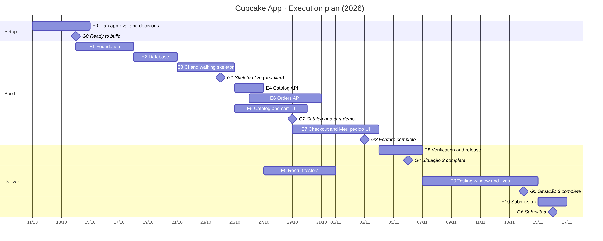

# 08 · Execution Plan

| | |
|---|---|
| **Version** | 2.6 (18 Oct 2026) |
| **Status** | Approved on 11 Oct 2026. v1.0.0 released on 17 Oct; the fixes from user validation (E9-07…E9-13) are implemented and await review before the v1.1.0 release. Live status: §16. |
| **Owner** | Tiago Pace Greggio (RGM 34852191) |
| **Related** | [01-prd.md](01-prd.md) §9–§10 (backlog, T-ids) · [02-architecture.md](02-architecture.md) · [04-ui-design-system.md](04-ui-design-system.md) · [05-testing-strategy.md](05-testing-strategy.md) · [06-development-workflow.md](06-development-workflow.md) · [07-api-spec.md](07-api-spec.md) |

This plan breaks the build into **small, verifiable tasks** grouped in phases. Every task names what it implements (US / BR / T-id), what it depends on, what it produces and how to check it's done. Every phase ends with a **review gate** where the owner validates the result before the next phase starts. Progress is tracked in this file (§16).

---

## 1. How to use this plan

### 1.1 Rules

1. **One task = one branch = one PR.** Branch name: `feat/<task-id>-<slug>` (e.g. `feat/e6-05-order-transaction`). Bigger than ~6 h? Split it before starting.
2. **Follow the order.** A task starts only when its dependencies are ✅ and its phase gate's predecessor is approved. Tasks without a dependency between them may run in any order inside the phase.
3. **The docs are the spec.** Each task lists the documents to read. If something isn't specified, **decide it in the docs first** (06 §3). Never add scope.
4. **Done means the acceptance criteria are met** *and* the Definition of Done (06 §3) holds (lint, types, tests, docs, copy, visual check for UI).
5. **Update this file in the same PR**: tick the task (§16), add actual hours and the PR link.
6. **Gates are real stops.** At a gate the checklist is presented with evidence; the owner approves, or lists fixes that become new tasks.
7. **External or irreversible actions** (creating Vercel/Neon resources, deploying to production, running migrations on production, deleting anything) need the owner's explicit go-ahead at the moment they happen.

### 1.2 Task card (template)

Every task below follows this card; the tables are its compact form.

| Field | Meaning |
|---|---|
| **ID** | `E<phase>-<nn>` |
| **Implements** | US / BR / NFR / T-id from the PRD |
| **Read first** | Docs and sections that define it |
| **Depends on** | Task IDs that must be ✅ |
| **Outcome** | Files / behavior produced |
| **Acceptance criteria** | Objective checks (tests, commands, visual comparison) |
| **Estimate** | Hours (from PRD §10; new tasks marked *new*) |

### 1.3 Task routine

Each task follows the routine in `06-development-workflow.md` §7: restate the task and the tests from the referenced docs, implement test-first, run the checks, compare UI screens at 390 and 1280 px, then update §16 and open the PR.

---

## 2. Phase overview

| Phase | Name | Goal | Tasks | Est. h | Target window | Hard deadline (milestone) |
|---|---|---|---|---|---|---|
| **E0** | Plan approval and setup decisions | Approve this plan; close open items; accounts and repo ready | 6 | 8 | 11–14 Oct | **G0** before any code |
| **E1** | Foundation | Monorepo, web and API skeletons, error model, security | 7 | 12 | 15–18 Oct | n/a |
| **E2** | Database | Prisma schema, migrations, constraints, seed | 5 | 9 | 18–20 Oct | n/a |
| **E3** | CI and walking skeleton | CI green; web + API + DB live on Vercel/Neon | 3 | 8 | 20–24 Oct | **G1 · 24 Oct** skeleton live |
| **E4** | Catalog API | Products and filters endpoints, contract tests | 4 | 9 | 24–25 Oct | n/a |
| **E5** | Catalog and cart UI | SCR-01 and SCR-02 as approved | 11 | 37 | 25–29 Oct | **G2 · 29 Oct** catalog + cart demo, cut-list check |
| **E6** | Orders API | Order creation transaction and public order | 6 | 23 | 26–30 Oct | n/a |
| **E7** | Checkout and Meu pedido UI | SCR-03, SCR-04, home card | 13 | 34 | 29 Oct–3 Nov | **G3 · 3 Nov** feature complete |
| **E8** | Verification and release | E2E, visual, a11y, performance, docs, video, v1.0.0 | 8 | 27 | 4–6 Nov | **G4 · 6 Nov** Situação 2 complete |
| **E9** | User validation and fixes | 5 testers, fixes, quality report | 6 | 20 | 31 Oct–14 Nov | **G5 · 14 Nov** Situação 3 complete |
| **E10** | Submission | Template, README, final checks, submit | 3 | 5 | 15–16 Nov | **G6 · 16 Nov** submitted (buffer 17 Nov) |
| | **Total** | | **72** | **192** | | Due **17 Nov 2026** |

Development effort (E1–E7 + E8-01) is **136 h**, matching the PRD task breakdown; the other 56 h are planning, documentation, validation and delivery work. Starting E1 right after G0 (instead of 20 Oct as in the overview) gives about **five days of buffer** before the official milestones.

### 2.1 Phase dependencies and critical path

Source: [`diagrams/planning/execution-plan.mmd`](diagrams/planning/execution-plan.mmd).

Critical path: **E1 → E2 → E3 (G1) → E6 → E7 (G3) → E8 (G4) → E9 (G5) → E10**. E4/E5 run in parallel with E6 once E3 is done; E5 needs E4, E7 needs E5 and E6.

---

## 3. E0 · Plan approval and setup decisions (owner, no code)

**Goal:** everything needed to start coding is decided and available.
**Outcome:** approved plan; open items closed in the docs; empty GitHub repository with the docs; accounts ready.

| ID | Task | Implements | Depends on | Outcome | Acceptance criteria | h |
|---|---|---|---|---|---|---|
| E0-01 | Review and approve this plan | n/a | n/a | Owner's approval recorded in the gate log (§16) | Gate log has the G0 line with date | 1 |
| E0-02 | Close design open items | A-08, UI doc §11 G-1, G-4 | E0-01 | Decisions: privacy line at checkout (yes/no + copy), the five *(proposed)* messages, desktop subtitle | PRD/UI doc/overview updated; no "open" left for these items | 1 |
| E0-03 | Ask the tutor about the back-end language | R-01 | n/a | Message sent; reply stored in `docs/situacao-1/` | Message sent (date logged); reply filed when received | 0.5 |
| E0-04 | Create the GitHub repository and push the docs | 06 §2 | E0-01 | Public repo `cupcake-app` with `docs/`, branch protection on `main` | Repo URL in README draft; `main` protected (PR + CI required once CI exists) | 1 |
| E0-05 | Accounts ready (owner) | 02 §10 | n/a | Vercel account (Hobby) linked to GitHub; Neon via Vercel Marketplace available | Owner confirms; no resources created yet | 0.5 |
| E0-06 | Situação 1 package (pt-BR) | Overview §5, D-01 | E0-02 | `docs/situacao-1/README.md` (índice), `alteracoes-pit-i.md`, `revisao-por-pares.md` (template; critiques collected 19–21 Oct) | Files exist, link every Situação 1 artifact; peer-review form ready to send | 4 |

**Gate G0 · Ready to build**: ✅ plan approved (11 Oct) · ✅ open items decided (E0-02, D-22) · ✅ repo created · ✅ accounts ready.

> The owner started E1 before E0-03 and E0-06 were done; the repository and the accounts (E0-04, E0-05) were ready before E3.

---

## 4. E1 · Foundation

**Goal:** a monorepo where web and API start locally, with the error model and security in place.
**Read first:** 02-architecture §3–§9, 06 §1 and §3.
**Outcome:** `pnpm dev` runs web (:3000) and API (:4000); `GET /api/health` responds; lint/types/tests run.

| ID | Task | Implements | Depends on | Outcome | Acceptance criteria | h |
|---|---|---|---|---|---|---|
| E1-01 | Monorepo scaffold | T-X-1 | G0 | `pnpm-workspace.yaml`, `tsconfig.base.json` (strict, `noUncheckedIndexedAccess`), ESLint 9 flat + Prettier, `.nvmrc` (24), `.editorconfig`, root scripts (06 §1) | `pnpm install && pnpm lint && pnpm typecheck` pass on an empty workspace; versions pinned (no `^` on frameworks) | 2 |
| E1-02 | `packages/shared` skeleton | T-X-1 · BR-12 (config) | E1-01 | `store.ts` (STORE constants, A-03), `error-codes.ts` (7 codes = openapi), `index.ts` | Unit test: error codes equal the `ErrorCode` enum in `openapi.yaml` | 1 |
| E1-03 | `apps/web` scaffold | T-X-1 · D-19 | E1-01 | Next.js 16 App Router, Tailwind v4, shadcn/ui init (Base UI), `globals.css` copied from `docs/design/theme/`, Plus Jakarta Sans via `next/font`, `/api/*` rewrite, security headers, placeholder home | `pnpm --filter web build` passes; page renders with the font; no extra theme files; `components/ui` untouched | 1 |
| E1-04 | `apps/api` scaffold | T-X-3 | E1-01 | `app.ts` (`buildApp`), `index.ts` (Vercel entry), `config.ts` (Zod env, fail fast), `GET /api/health` (no DB yet), pino logger, request id header | `app.inject` test: health 200 with `x-request-id`; missing env var exits with a clear message | 3 |
| E1-05 | Error model and global handler | T-X-3 · NFR-07 | E1-04 | `AppError`, handler mapping Zod → `VALIDATION_ERROR`, unknown route → `NOT_FOUND`, other → `INTERNAL_ERROR` | Tests: each mapping returns the `ErrorResponse` shape; 500 body has no stack | 1 |
| E1-06 | Security plugins and log redaction | T-X-7 · NFR-05, NFR-06 | E1-05 | helmet, CORS (`WEB_ORIGIN`), rate-limit (configurable), pino `redact` | Tests: CORS rejects other origins; 429 with low limit; captured logs contain no phone | 3 |
| E1-07 | Local database and env | T-X-2 (part) | E1-01 | `docker-compose.yml` (postgres:16, `cupcake_dev` + `cupcake_test`), `.env.example`, README "Local setup" | `docker compose up -d db` works; README steps reproduce from a clean clone | 1 |

---

## 5. E2 · Database

**Goal:** the physical model of `03-data-model.md` running through Prisma, with constraints and seed.
**Read first:** 03-data-model §3, §6–§10, `physical-model.sql`, 06 §5.
**Outcome:** migrations create a schema equivalent to the DDL; seed loads six products; API health checks the DB.

| ID | Task | Implements | Depends on | Outcome | Acceptance criteria | h |
|---|---|---|---|---|---|---|
| E2-01 | Prisma 7 schema and client | T-X-2 | E1-07 | `schema.prisma` (7 models, `PickupStatus` enum, `@@map`/`@map`), `prisma.config.ts`, `prisma-client` generator, `@prisma/adapter-pg`, exported client | `prisma validate` passes; generated client builds | 2 |
| E2-02 | Migrations with CHECK constraints | T-X-2 · NFR-08 | E2-01 | Initial migration + raw SQL migration with every CHECK from `physical-model.sql` | Schema-diff test vs `physical-model.sql` passes; the 14 constraint tests of 03 §9 pass | 1 |
| E2-03 | Seed script and photos | T-21-1 · US-21 AC1 | E2-02 | `seed.ts` (upsert by slug; never resets existing stock), photos copied to `apps/web/public/images/products/` | `pnpm db:seed` loads 3 categories, 1 tag, 6 products in display order, 3 bestsellers | 3 |
| E2-04 | Seed tests | T-21-2 · US-21 AC2–AC3 | E2-03 | Integration tests for the seed | Running twice creates no duplicates; one low-stock and one sold-out product; bestseller per category | 2 |
| E2-05 | Prisma plugin in the API + DB health | T-X-3 | E2-02, E1-04 | Fastify Prisma plugin (connect/disconnect), health runs `SELECT 1` | Health returns `database: "ok"`; 500 `INTERNAL_ERROR` when DB down (test) | 1 |

---

## 6. E3 · CI and walking skeleton

**Goal:** every PR is checked automatically; the skeleton is live end to end.
**Read first:** 06 §4–§6, 02 §9–§10.
**Outcome:** CI green on `main`; production URLs for web and API; health reachable through the web origin.

| ID | Task | Implements | Depends on | Outcome | Acceptance criteria | h |
|---|---|---|---|---|---|---|
| E3-01 | GitHub Actions CI | T-X-4 · NFR-10 | E2-04 | `ci.yml` jobs `quality` and `test` (Postgres service), Redocly lint, coverage thresholds wired | A PR shows both jobs green; a failing test blocks merge (branch protection on) | 3 |
| E3-02 | Cloud resources (**owner approves**) | T-X-5 · D-20 · D-23 | E3-01, E0-05 | Neon project (`main` + `preview` branches), one Vercel project `cupcake-app` with `web` (`apps/web`) + `api` (`apps/api`) Services (`vercel.json`), env vars set, same region | Owner confirms the resources; env vars match 02 §9; secrets only in Vercel/GitHub | 2 |
| E3-03 | Deploy the walking skeleton | T-X-5 | E3-02 | Release workflow (`migrate deploy` + seed + health smoke), both projects deployed | `https://<web>/api/health` returns `{status:"ok",database:"ok"}`; PR previews build; tag `v0.1.0` | 3 |

**Gate G1 · Skeleton live (24 Oct)**: ☐ CI green and required · ☐ production health OK through the web origin · ☐ migrations + seed applied in Neon · ☐ README has live links · ☐ owner approved.

---

## 7. E4 · Catalog API

**Goal:** the catalog endpoints exactly as in the contract.
**Read first:** 07 §3.2–§3.3, `openapi.yaml`, 05 §3.2–§3.4, SD-01.
**Outcome:** `GET /api/catalog/filters` and `GET /api/products` with contract tests; typed web client generated.

| ID | Task | Implements | Depends on | Outcome | Acceptance criteria | h |
|---|---|---|---|---|---|---|
| E4-01 | Contract helper and web client generation | T-01-1 (part) · D-21 | E3-01 | `expectToMatchContract()` (Ajv + `openapi.yaml`), `gen:api` script, `openapi-fetch` client in web, CI diff check | A deliberately wrong response fails the helper; generated `schema.d.ts` committed and checked in CI | 1 |
| E4-02 | `GET /api/products` | T-01-1 · US-01 AC1, AC4 · BR-04 | E4-01, E2-05 | Route, controller, CatalogService, ProductRepository | Integration: all active in seed order; inactive hidden; contract match | 3 |
| E4-03 | Stock state and max quantity | T-04-1 · US-04 · BR-04, BR-06 | E4-02 | `stockState`, `maxQuantity` in the service | Unit: 0/1/5/6 boundaries; `min(stock,20)` | 2 |
| E4-04 | Filters endpoint and filtering | T-02-1 · US-02, US-03 · BR-02, BR-03 | E4-02 | `GET /api/catalog/filters`; `category` / `tag` query | Integration: order by sortOrder; category; tag; both → 400; unknown slug → `[]` | 3 |

---

## 8. E5 · Catalog and cart UI

**Goal:** SCR-01 and SCR-02 match the approved design and behave per the stories.
**Read first:** 04-ui-design-system §4–§8 (components, screens 7.1–7.2, copy §9), screenshots `01`, `02`, `03`, `07`, `08`; PRD US-01–US-10.
**Outcome:** customer can browse, filter, add to cart, edit and review the cart on mobile and desktop.

| ID | Task | Implements | Depends on | Outcome | Acceptance criteria | h |
|---|---|---|---|---|---|---|
| E5-01 | Base layout and formatting | T-X-6 · NFR-04 | E1-03 | shadcn components added (button, badge, input, label, alert, skeleton, separator, toggle-group, sonner), AppHeader (catalog + inner variants), Footer/StoreInfo, `format.ts` | Unit: `R$ 11,90`, times in America/Sao_Paulo; header and footer match screenshot `01` at 390 px | 5 |
| E5-02 | Catalog page with product cards | T-01-2 · US-01 AC1–AC3 · US-04 | E5-01, E4-03 | SSR catalog, ProductCard (bestseller, low, sold-out states), loading skeleton, error state | Component tests per state; matches `01` (390) and `08` (1280); error/loading match `07` | 5 |
| E5-03 | Filter chips with URL sync | T-02-2 · US-02 | E5-02, E4-04 | FilterChips (single row, hidden scrollbar on mobile), `?filter=`, empty state | US-02 AC1–AC4 tests; **no heading** for the filter; no horizontal page overflow at 360 px | 3 |
| E5-04 | Bestsellers filter and badge | T-03-1 · US-03 | E5-03 | `bestsellers` chip → `tag=bestseller`; badge on cards | US-03 AC1–AC2 tests | 2 |
| E5-05 | Cart store | T-05-1 · BR-17 | E1-03 | Zustand + persist (`cupcake.cart`), add/merge/set/remove/clear, total units | Unit tests incl. persistence and corrupt storage | 4 |
| E5-06 | Add button, card stepper, toast | T-05-2 · US-05 | E5-05, E5-02 | "+" → stepper on the photo; minus at 1 removes; toast with "Ver carrinho" | US-05 AC1–AC3 component tests; matches `01`/`02` | 3 |
| E5-07 | Client quantity limits | T-06-1 · US-06 AC1–AC3 | E5-06 | Plus disabled at `maxQuantity`; "Máximo disponível." | Component + unit tests; matches `02` | 3 |
| E5-08 | Header cart badge | T-07-1 · US-07 | E5-05, E5-01 | Count of units, `aria-label`, hidden at 0 | US-07 AC1–AC2 tests | 2 |
| E5-09 | Cart page | T-08-1 · US-08 | E5-05, E5-01 | CartLine (92 px photo), totals box, sticky "Continuar", empty state | US-08 AC1–AC3; matches `03` and empty state in `07` | 4 |
| E5-10 | Edit and remove with confirmation | T-09-1 · US-09 | E5-09 | Cart stepper, inline remove confirmation | US-09 AC1–AC3 tests; matches `07` "remover item" | 3 |
| E5-11 | Cart refresh against stock and price | T-10-1 · US-10, US-08 AC4 | E5-09, E4-02 | Reconcile with `GET /api/products`; warning notice | US-10 AC1–AC3 tests; notice copy from UI §9.2 | 3 |

**Gate G2 · Catalog and cart demo (29 Oct)**: ☐ demo on a phone (preview URL) · ☐ visual comparison 01, 02, 03, 07, 08 attached · ☐ all E5 tests green · ☐ **cut-list check**: if E6+E7 remaining hours exceed the days left, apply the PRD cut order (T-X-8 → US-07 → US-10 → US-03 → US-22) · ☐ owner approved.

---

## 9. E6 · Orders API

**Goal:** correct, atomic order creation and the public order view.
**Read first:** 07 §3.4–§3.5, 02 §6.1–§6.2, 03 §6, SD-02, SD-04, PRD BR-10–BR-16, BR-19.
**Outcome:** `POST /api/orders` and `GET /api/orders/{code}` per contract, with concurrency proven by tests.

| ID | Task | Implements | Depends on | Outcome | Acceptance criteria | h |
|---|---|---|---|---|---|---|
| E6-01 | Shared order schema and phone normalization | T-12-1 · US-12 AC1–AC3 · BR-14 | E1-02 | `createOrderSchema`, `normalizePhone`, messages | Unit: the formats of US-12 AC3 normalize; invalid cases of 05 §3.1 rejected | 3 |
| E6-02 | Order code generator | T-16-1 · BR-13 | E1-02 | `generateOrderCode()` (31-char alphabet, injectable for tests) | Unit: format; no ambiguous characters; uniqueness over 10 000 | 2 |
| E6-03 | Stock decrement repository | T-06-2 · BR-05 | E2-05 | `decrementStock(tx, productId, qty)` → affected rows; read current stock | Integration: success and 0-row cases | 3 |
| E6-04 | `POST /api/orders` | T-11-1 · US-11 AC2 · BR-07, BR-08, BR-10, BR-13, BR-15 | E6-01, E6-02, E6-03 | Route, controller, OrderService.create (validation, upsert, totals, code retry), `Location` header | Integration per 05 §3.2: 201 shape, customer reuse, validation 400s, `PRODUCT_NOT_FOUND` 409, no phone in body; contract match | 6 |
| E6-05 | Atomic transaction and concurrency | T-15-1 · US-15 AC1, AC4 · US-19 AC1, AC3 · BR-11 | E6-04 | Single interactive transaction, product-id ordering, rollback on shortage, all short lines listed | Integration: 2 parallel orders for the last unit → one 201, one 409, final stock 0; nothing written on 409 | 6 |
| E6-06 | `GET /api/orders/{code}` | T-18-1 · US-18 AC1–AC2 · BR-12, BR-16 | E6-04 | Public view with `customerFirstName`, `readyAt`; 404 for unknown/malformed | Integration + contract; lowercase code works | 3 |

---

## 10. E7 · Checkout and Meu pedido UI

**Goal:** SCR-03, SCR-04 and the home latest-order card as approved, completing the journey.
**Read first:** 04-ui-design-system §6.2, §6.7–§6.13, §7.3–§7.4, §8.3, §9.3–§9.5; screenshots `04`, `05`, `06`, `09`, `01` (card); PRD US-11–US-22; SD-02, SD-03; AD-02.
**Outcome:** a customer places an order, lands on Meu pedido, and sees the home card afterwards.

| ID | Task | Implements | Depends on | Outcome | Acceptance criteria | h |
|---|---|---|---|---|---|---|
| E7-01 | Pickup and store info blocks | T-17-1 · US-17 | E5-01 | `PickupInfo` ("Retirada", "Onde retirar") from `STORE` | US-17 AC1–AC2 tests | 2 |
| E7-02 | Checkout form and guards | T-11-2 · US-11 AC1, AC3–AC5 | E6-01, E5-05 | Nome/Celular fields (mask), empty-cart redirect, loading "Enviando…" | Component tests; matches `04` and loading state in `06` | 3 |
| E7-03 | Field errors (client + server) | T-12-2 · US-12 AC1, AC2, AC4 | E7-02 | Errors on blur/submit; server `fields[]` mapped by path | Component tests; matches `06` | 2 |
| E7-04 | Order summary and pickup block | T-13-1 · US-13 | E7-01, E5-05 | OrderSummary (mobile stacked, desktop aside), "Editar" | US-13 AC1–AC3; matches `04` and `09` | 3 |
| E7-05 | Payment-at-store copy | T-14-1 · US-14 · NFR-12 | E7-04 | "Pagamento na loja", "Total a pagar na loja" | US-14 AC1–AC3; test asserts no payment fields/strings anywhere in the app | 2 |
| E7-06 | Latest-order store | T-22-1 · BR-19 | E1-03 | `lastOrderStore` (save/read/clear, today rule, try/catch) | Unit: midnight boundaries in America/Sao_Paulo; storage unavailable doesn't throw | 2 |
| E7-07 | Submit flow to Meu pedido | T-15-2 · US-15 AC1–AC3 | E6-05, E7-02, E7-06 | POST via typed client; on 201 clear cart, save latest order, `replace('/orders/{code}?new=1')`; retry on network error | Component tests with mocked API; E2E-1 path works locally | 3 |
| E7-08 | Stock and product errors at checkout | T-19-1 · US-19 AC1–AC3 | E7-07 | Danger notice + "Revisar", red summary line, cart adjusted on return | US-19 tests; matches `06` | 4 |
| E7-09 | Meu pedido page | T-16-2 · US-16 AC1 | E6-06, E7-01 | SSR order page: success notice (only `?new=1`, then removed), code card, summary, "Onde retirar", "Voltar ao início" | Component tests; matches `05` | 4 |
| E7-10 | Copy code with fallback | T-16-3 · US-16 AC3 | E7-09 | Clipboard API, select-text fallback, toast "Código copiado" | Component tests for both paths | 2 |
| E7-11 | Order page states | T-18-2 · US-18 AC2–AC3 | E7-09 | Not found, reopened (no notice), error + retry | Component tests; not-found matches `07` | 2 |
| E7-12 | Home latest-order card | T-22-2 · US-22 | E7-06, E6-06, E5-02 | LatestOrderCard with AD-02 rules; stale code removal | US-22 AC1–AC4 tests; matches `01` (390) and `08` (1280) | 3 |
| E7-13 | Staff readability check | T-20-1 · US-20 | E7-09 | Review at 360 px: items, quantities, total legible | US-20 AC1–AC2 checked (manual note + integration from E6-06) | 2 |

**Gate G3 · Feature complete (3 Nov)**: ☐ every US-01…US-22 AC has a passing test or documented manual check (05 §5) · ☐ full journey works on preview from a phone · ☐ visual comparison of all 9 references attached · ☐ no open bugs of severity high · ☐ tag `v1.0.0-rc.1` · ☐ owner approved.

---

## 11. E8 · Verification and release

**Goal:** prove the product meets the spec (V&V) and ship v1.0.0; produce Situação 2 deliverables.
**Read first:** 05 (all), 06 §9, overview §5.
**Outcome:** production v1.0.0, test report, user manual, video, Situação 2 folder.

| ID | Task | Implements | Depends on | Outcome | Acceptance criteria | h |
|---|---|---|---|---|---|---|
| E8-01 | End-to-end journeys | T-X-8 | G3 | Playwright E2E-1…E2E-5, mobile + desktop projects, in CI | All green in CI on `main` | 4 |
| E8-02 | Visual, accessibility and performance checks | *new* · NFR-01–NFR-03, NFR-02 | E8-01 | Playwright snapshots, axe report, Lighthouse mobile report | 0 serious/critical axe issues; Lighthouse Perf ≥ 85, A11y ≥ 95 (05 §4) | 4 |
| E8-03 | Manual test session | *new* · NFR-11 | E8-01 | 05 §6 checklist on Android + iPhone + 4 desktop browsers | Checklist filled with results and screenshots | 2 |
| E8-04 | Production release v1.0.0 (**owner approves**) | 06 §6, §9 | E8-02, E8-03 | Migrations, seed stock for testing, deploy, smoke test | Release checklist 06 §9 all ticked; tag `v1.0.0` | 2 |
| E8-05 | Test report (V&V, pt-BR) | *new* · S-II | E8-04 | `docs/situacao-2/relatorio-de-testes.md` with CI links, coverage, AC table, Lighthouse, manual results | Every AC listed with pass/fail and evidence link | 5 |
| E8-06 | User manual | *new* | E8-04 | `docs/user-manual.md` with screenshots of the production app | Covers the full journey and pickup; links work | 3 |
| E8-07 | Narrated video (≥ 5 min) | *new* · S-II | E8-04 | Script in `docs/situacao-2/roteiro-video.md`; video link | Video shows journey, code structure (MVC), tests, deploy; ≥ 5 min | 6 |
| E8-08 | Situação 2 index | *new* | E8-05–E8-07 | `docs/situacao-2/README.md` (pt-BR): repo, app, video links | All links open logged out | 1 |

**Gate G4 · Situação 2 complete (6 Nov)**: ☐ v1.0.0 live · ☐ test report, manual, video published · ☐ owner approved.

## 12. E9 · User validation and fixes

**Goal:** validate with 5 real users, fix what they find, document quality (Situação 3).
**Read first:** 05 §7, overview §10 (P7), R-03, R-06.

| ID | Task | Implements | Depends on | Outcome | Acceptance criteria | h |
|---|---|---|---|---|---|---|
| E9-01 | Tester recruitment and form | *new* · R-03 | E0-06 | 5 testers + 1 spare confirmed by **31 Oct**; Google Form (tasks + satisfaction questions, consent) | Names (with consent) and form link in `docs/situacao-3/` | 2 |
| E9-02 | Testing window 7–10 Nov | *new* | G4, E9-01 | Testers use production; responses exported to PDF | 5 complete responses; PDF in `docs/situacao-3/` | 2 |
| E9-03 | Triage and fixes | *new* (buffer) | E9-02 | Issues logged with severity; fixes as normal tasks (branch + tests); re-test. **Split on 18 Oct into E9-07…E9-14 below** | All high/medium issues fixed or justified; tag **`v1.1.0`** (behavior changes, not just a `v1.0.x` patch) | 8 |
| E9-04 | Quality report (laudo) | *new* | E9-03 | `docs/situacao-3/laudo-de-qualidade.md`: findings, fixes, metrics, before/after | Each finding traced to a fix or decision | 3 |
| E9-05 | Updated video (≤ 5 min) | *new* | E9-03 | Script `roteiro-video-atualizado.md` + link | Shows changes after validation; ≤ 5 min | 4 |
| E9-06 | Situação 3 index | *new* | E9-04, E9-05 | `docs/situacao-3/README.md` (pt-BR) | All links work logged out | 1 |

| E9-07 | Tester report and spec changes | *new* · E9-03 | E9-02 | `docs/situacao-3/relatorio-de-testes.md` (pt-BR, triage table); PRD v1.4 (BR-12, BR-19 rewritten, BR-20, BR-21, US-22 rewritten, US-23…US-25), overview D-24…D-28, UI doc v1.8, this plan | Every finding maps to a story, a decision or an out-of-scope justification; owner reviews the docs before any code | 2 |
| E9-08 | Database: order schedule and EXPIRED | US-25, BR-12, BR-20 · D-25 | E9-07 | `orders.ready_at`/`expires_at`; status `EXPIRED`; migration with backfill; `physical-model.sql` and `03-data-model.md` updated | Migration applies on an empty and a populated database; schema-diff tests pass | 2 |
| E9-09 | Store config and pickup schedule | BR-12 · D-24 | E9-08 | `STORE` config, `computePickup` and `formatOpeningHours` in `packages/shared`; order creation stores `readyAt`/`expiresAt` | Orders at 22h, on Monday and at 18:31 get the right times; contract tests pass | 4 |
| E9-10 | Order expiry and staff pickup | US-24, US-25, BR-20, BR-21 · D-25, D-26 | E9-09 | Lazy `expireOverdue` releasing stock once; `PATCH /api/orders/{code}/pickup` with `STAFF_API_TOKEN`; error codes `UNAUTHORIZED`, `INVALID_ORDER_STATUS` | Concurrency test shows stock released once; all 401/404/409 paths tested; docs 02, 06, 07 and `openapi.yaml` updated | 6 |
| E9-11 | Web: ready and expiry copy | US-13 AC4, US-16, US-17, US-18 AC4 · D-24 | E9-09 | Header, footer and pickup rows from `STORE`; ready label and pickup deadline; expired and picked-up notices | First paint without loading states; copy matches `04` §9 | 3 |
| E9-12 | Web: several active orders and share | US-22, US-23 · D-27, D-28 | E9-10 | `cupcake.orders` store (max 5, migration of `cupcake.lastOrder`); one card per active order; "Compartilhar" | A previous-day order still shows its card; pruning on 404/PICKED_UP/EXPIRED; share and fallback tested | 5 |
| E9-13 | Web: guidance at the cap of 20 | US-06 AC5 · D-28 | E9-07 | `card.max.cap` message on the card and the cart line | Shown only when the cap (not the stock) is the limit | 1 |
| E9-14 | Release v1.1.0 and re-test | E9-03 | E9-08…E9-13, owner review | `STAFF_API_TOKEN` configured; Neon `preview` then `main` migrated and seeded; tag `v1.1.0`; the findings re-tested on production | Owner approves each step; results recorded in the test report | 2 |

**Gate G5 · Situação 3 complete (14 Nov)**: ☐ tests PDF, report, video published · ☐ production on the final tag · ☐ owner approved.

## 13. E10 · Submission

| ID | Task | Implements | Depends on | Outcome | Acceptance criteria | h |
|---|---|---|---|---|---|---|
| E10-01 | Fill the official template | *new* | G5 | `PIT_atividade.docx` completed (pt-BR), linking all Situações | Every required section filled; links tested | 3 |
| E10-02 | Final repository check | 06 §9 | E10-01 | README final (live links, setup, disclosure line A-06), release tag, change logs | All links open logged out; CI green; no secrets | 1 |
| E10-03 | Submit (owner) | D-14 | E10-02 | Submission on the course platform | Confirmation saved | 1 |

**Gate G6 · Submitted by 16 Nov** (buffer: 17 Nov).

---

## 14. Risk controls built into the plan

| Risk | Control in this plan |
|---|---|
| R-02 timeline | Start after G0 (≈5 days buffer); G2 cut-list check on 29 Oct; E9-03 has an 8 h fix buffer |
| R-04 cold starts / hosting | Walking skeleton by G1; health smoke test in the release workflow; warm-up before sessions |
| R-05 docs vs code drift | Each task updates its docs in the same PR; gates check traceability (05 §5) |
| R-07 UI drift | Visual comparison is an acceptance criterion of every UI task and of G2/G3 |
| R-03 testers | E9-01 deadline 31 Oct, long before the window |
| AR-3 Prisma 7 on Vercel | Proven in E3-03 with a real query before feature work |

## 15. Change control

- New needs or changes go to the owner first, then the PRD/UI doc, then become tasks here (new ID, never reuse).
- Re-estimate at each gate; if the plan slips more than one day against a milestone, apply the cut list and record it in the gate log (§16).
- Never mark a task ✅ with failing tests or unmet criteria; split the remaining work into a new task instead.

---

## 16. Progress tracker

Status: ☐ to do · ◐ in progress · ✅ done · ✂ cut. Update in each task's PR.

| ID | Status | Actual h | PR | Notes |
|---|---|---|---|---|
| E0-01 | ✅ | 0.2 | n/a | Owner approved the plan in chat, 11 Oct 2026 |
| E0-02 | ✅ | 0.3 | n/a | Owner decided: add LGPD line, approve the 5 proposed strings, remove desktop subtitle everywhere. Applied in `04-ui-design-system.md` v1.2, `00-project-overview.md` D-22/A-08 |
| E0-03 | ☐ | | | |
| E0-04 | ✅ | | n/a | Repo `tiagopacedev/cupcake-app` public; `main` protected (`quality` + `test` required) |
| E0-05 | ✅ | | n/a | Vercel (Hobby) linked to GitHub; Neon available |
| E0-06 | ☐ | | | |
| E1-01 | ✅ | 2 | n/a (repo not on GitHub yet, E0-04) | pnpm workspace, tsconfig.base.json, ESLint 9 flat + Prettier, .nvmrc (24), .editorconfig; `pnpm install/lint/typecheck` pass. Sandbox runs Node 22.22, not 24 LTS (E0-05/CI/Vercel will use 24) |
| E1-02 | ✅ | 1 | n/a | `store.ts`, `error-codes.ts`, `index.ts`; contract test parses `openapi.yaml`'s `ErrorCode` enum and asserts equality — 8/8 tests pass |
| E1-03 | ✅ | 1 | n/a | Next.js 16 App Router, Tailwind v4 + `@tailwindcss/postcss`, `globals.css` copied verbatim from `docs/design/theme/`, Plus Jakarta Sans via `next/font/google`, `/api` rewrite, security headers, placeholder home, `components.json` + `lib/utils.ts` (shadcn init, `components/ui` left empty for E5). `next dev` serves 200; **`next build` could not be verified in this sandbox** — its network allowlist blocks `fonts.googleapis.com` (403), which Turbopack's production build treats as fatal (dev mode only warns and falls back). Will be confirmed at E3 in CI/Vercel, which have normal internet access |
| E1-04 | ✅ | 3 | n/a | `buildApp()`/`index.ts`, Zod `config.ts` (fails fast, `DATABASE_URL`/`DIRECT_URL` optional until E2), `GET /api/health`, pino logger, `x-request-id` echoed/generated. Verified both via `vitest`/`inject` and by running the real built `dist/index.js` and curling `/api/health` and an unknown route |
| E1-05 | ✅ | 1 | n/a | `AppError`, global handler mapping `AppError` → its code, Zod/Fastify-schema errors → `VALIDATION_ERROR`, 404 → `NOT_FOUND`, 429 → `RATE_LIMITED`, anything else → `INTERNAL_ERROR` with no stack in the body (stack only logged). 5/5 tests pass |
| E1-06 | ✅ | 3 | n/a | `@fastify/helmet`, `@fastify/cors` (origin allow-list = `WEB_ORIGIN`), `@fastify/rate-limit` (default 120/min, test-overridable), pino `redact` for `*.phone`/customer name. Tests: CORS header present/absent by origin, helmet header set, 429 after a low test limit, two redaction tests confirming no raw phone reaches the log stream |
| E1-07 | ✅ | 1 | n/a | `docker-compose.yml` (postgres:16, `cupcake_dev` + an init script creating `cupcake_test`), `.env.example`, root `README.md` "Local setup". **Not run in this sandbox** — no Docker daemon available here; local PostgreSQL 16 (installed from Phase 2) was used directly instead to smoke-test the API. `docker compose up -d db` itself is unverified and should be checked on the owner's machine or in CI |
| E2-01 | ✅ | 2 | n/a | `schema.prisma` (7 models, `PickupStatus` enum, every constraint/index pinned with `map`/`@@map` to match `physical-model.sql`), `prisma.config.ts` (CLI uses `DIRECT_URL`), `src/client.ts` (`createPrismaClient(url)` + lazy `getPrisma()` singleton via `@prisma/adapter-pg`, Neon **pooled** `DATABASE_URL`). **`prisma generate`/`validate` could not run in this sandbox** — same `binaries.prisma.sh` 403 block as E1-03's Google Fonts block, confirmed again this session (`schema-engine.gz.sha256` fetch refused). Typechecked `client.ts`/`index.ts`/`seed.ts` and all of `apps/api` against a throwaway local stub matching the expected generated shape (removed before commit, never part of the repo) — 0 type errors; real verification against the actual generated client is owner-side (CI/Vercel/dev machine) |
| E2-02 | ✅ | 1 | n/a | Both migrations hand-written (schema-engine blocked, so couldn't be generated) and applied for real: to the project's own cloud database (Neon project `cupcake-app`, via Neon's SQL tools — no `binaries.prisma.sh` dependency) **and**, for test evidence, to a real local PostgreSQL 16 (this sandbox has a native `postgresql-16` package, unlike E1-07's Docker gap). **Schema-diff and the 14 `03-data-model.md` §9 constraint tests actually ran and passed** — 7/7 and 14/14 (`packages/database/test/schema-diff.int.test.ts`, `constraints.int.test.ts`, via raw `pg`, no Prisma Client needed) |
| E2-03 | ✅ | 2 | n/a | `src/seed.ts`: idempotent upsert by slug; update clauses never touch `stockQuantity`, only `create` does (06-development-workflow.md §5). Seeded for real into the Neon database with the exact `03-data-model.md` §8 catalog (verified via SQL: 3 categories, 1 tag, 6 products, 3 bestsellers, Cookies & Cream stock 3, Lemon Cream stock 0) — caught and fixed a seeding mistake mid-session (an earlier manual seed had wrong names/prices/stock before `seed.ts` existed). Photos: `apps/web/public/images/products/` not touched yet — no photo assets available in this session; still open |
| E2-04 | ✅ | 2 | n/a | `packages/database/test/seed.int.test.ts`: shape (3/1/6/3-bestsellers, low-stock + sold-out), running twice creates no duplicates, and a changed stock value survives a re-seed. **Could not run in this sandbox** — needs a real generated Prisma Client (`seedCatalog`'s signature), unlike E2-02's raw-`pg` tests; typechecks clean against the stub described in E2-01. Verify with `pnpm test:int` once `prisma generate` succeeds |
| E2-05 | ✅ | 1 | n/a | `plugins/prisma.ts` (decorates `app.prisma`, built from `config.DATABASE_URL` — a fake override skips the real client in unit tests — disconnects `onClose`), `health.routes.ts` now runs a real `SELECT 1`. `config.ts`: `DATABASE_URL` required, `DIRECT_URL` removed (it's `database`-only per 02-architecture §9, not `api`'s). Split health tests: `health.test.ts` (fake Prisma, unit-level — 3/3 pass for real, confirmed via `pnpm --filter api test`) + new `health.int.test.ts` (real DB up/down, E2-05's AC) — the latter needs the real generated client, same gap as E2-04. `security.test.ts`/`config.test.ts` updated for the new required env var and fake-Prisma override; all 19 apps/api unit tests pass |
| E3-01 | ✅ | 3 | [#1](https://github.com/tiagopacedev/cupcake-app/pull/1) | `ci.yml`: `quality`/`test`/`audit` jobs, `postgres:16` service, Redocly lint, coverage gate (`--soft` until E4-E7). Merged to `main` as `3f12789`; branch protection on `main` requires `quality` + `test`. Fixed 3 real bugs real CI caught (not reproducible in-sandbox): `shared` package missing a `postinstall` build step; `test:int` script's glob silently excluded by each `vitest.config.ts`'s own `exclude` (gave it a separate `vitest.int.config.ts`); `prisma migrate deploy`'s `_prisma_migrations` table breaking schema-diff assertions, plus a cross-file race on shared fixture data (`fileParallelism: false`). `audit` fails non-blocking on pre-existing CVEs in Prisma's own dev deps |
| E3-02 | ✅ | 2 | n/a (direct to `main`, `113a9ad`) | Neon project `cupcake-app` (`sa-east-1`, branches `main` + `preview`); one Vercel project `cupcake-app` with `web` + `api` Services (D-23, `vercel.json`); production env vars set. Follow-ups done in E3-03: preview env vars (Neon `preview`, `DATABASE_URL` Sensitive), function region `gru1` to match Neon. Still owner-side: re-add production `DATABASE_URL` as Sensitive (the API can't convert it) |
| E3-03 | ✅ | 4 | `feat/e3-03-walking-skeleton` | Four deploy fixes landed on `main` first (`7ed2a9c`…`2e9739e`). Real root cause, found with a local `vercel build`: because `apps/api` had a `build` script, Vercel deployed our `tsc` output flattened to the function root, away from `apps/api/package.json` (→ loaded as CommonJS) and `node_modules` (→ `fastify` not found). Renamed it `build:dist`, so Vercel compiles `src/index.ts` itself, keeping the repo layout (`.mjs`). Latent second bug: `database` exported raw `.ts` (fails in plain Node) → now builds `dist/` like `shared`. Verified: plain `node dist/index.js` serves health; `vercel build` produces `apps/api/src/index.mjs` and traces only `database/dist`. Neon `main` baselined (`migrate resolve`), `preview` migrated + seeded. `release.yml` (dispatch: migrate → seed → smoke → tag). PR #2 merged, CI green, production `/api/health` → `{status:"ok",database:"ok"}` from `gru1`, `DIRECT_URL` secret set. Release workflow run 38152804764 (migrate no-op → seed → health smoke → tag) passed; tag `v0.1.0` created; G1 approved by the owner |
| E4-01 | ✅ | 1.5 (E4 total) | [#3](https://github.com/tiagopacedev/cupcake-app/pull/3) | `expectToMatchContract(res, operationId, status)` (Ajv 2020-12 + formats, resolves shared `$ref` responses); 6 unit tests incl. a deliberately wrong body and an extra property. `schema.d.ts` generated and committed, `openapi-fetch` client in `apps/web/src/lib/api/client.ts`; CI `quality` fails on a stale `schema.d.ts`. First real catch: the helper flagged that the API returned a bare array while `openapi.yaml` defines the `{ products }` envelope — fixed in the code, spelled out in 07 §3.3 |
| E4-02 | ✅ | | [#3](https://github.com/tiagopacedev/cupcake-app/pull/3) | `GET /api/products`: route → controller → `CatalogService` → `ProductRepository` (active only, order: category `sortOrder`, `createdAt`, name). Integration tests against real PostgreSQL: seed order, inactive hidden, contract match, no customer data |
| E4-03 | ✅ | | [#3](https://github.com/tiagopacedev/cupcake-app/pull/3) | `stock.service.ts`: `stockStateOf` (0 / 1 / 5 / 6 boundaries) and `maxQuantityOf` = min(stock, 20); unit tests plus the integration check on the seed (stock 40 → AVAILABLE/20, 3 → LOW/3, 0 → SOLD_OUT/0). `src/services` ≥ 90% coverage threshold now enforced in `apps/api/vitest.config.ts` |
| E4-04 | ✅ | | [#3](https://github.com/tiagopacedev/cupcake-app/pull/3) | `GET /api/catalog/filters` (categories by `sortOrder`, tags) and `?category=` / `?tag=`: both → 400, malformed slug → 400, unknown slug → `{ products: [] }`, inactive hidden while filtering. Done in one branch/PR with one commit per task (E4 is small and linear) instead of four PRs |
| E5-01 | ✅ | 1.5 (E5 total: 1.5 h in this session's estimate; to be corrected by the owner) | [#4](https://github.com/tiagopacedev/cupcake-app/pull/4) | shadcn components via the CLI (its `cn` import pointed at a third-party npm package; rewritten to `@/lib/utils`, versions pinned, `components/ui` otherwise untouched and Prettier-ignored); AppHeader (catalog + inner), CartLink, StoreFooter (stacked on mobile, one row on desktop), `format.ts` (R$, HH:mm, dd/mm in America/Sao_Paulo). Compared with screenshot 01 at 390 px |
| E5-02 | ✅ | | [#4](https://github.com/tiagopacedev/cupcake-app/pull/4) | Server-rendered catalog from `GET /api/products`; ProductCard states (bestseller, low, sold out); skeleton `loading.tsx`; failure state with "Tentar de novo"; photos copied to `public/images/products` (closes the open part of E2-03). Verified at 390 px (two 171 px columns) and 1280 px (three 352 px columns, footer in one row). Intended difference: API order vs mockup order (UI doc G-8) |
| E5-03 | ✅ | | [#4](https://github.com/tiagopacedev/cupcake-app/pull/4) | FilterChips (buttons with `aria-pressed`, `router.replace`, `?filter=`), no heading, hidden scrollbar, empty state "Nenhum cupcake aqui" |
| E5-04 | ✅ | | [#4](https://github.com/tiagopacedev/cupcake-app/pull/4) | `bestsellers` → `tag=bestseller`, categories → `category=<slug>`; badge on every card with the tag |
| E5-05 | ✅ | | [#4](https://github.com/tiagopacedev/cupcake-app/pull/4) | Zustand store persisted as `[{productId, quantity}]` in `cupcake.cart`, zod-validated, manual hydration (`CartHydrator`), never throws on corrupt/unavailable storage; 20 unit tests |
| E5-06 | ✅ | | [#4](https://github.com/tiagopacedev/cupcake-app/pull/4) | `CatalogProductCard`: "+" → stepper, "−" at 1 removes, toast with "Ver carrinho" |
| E5-07 | ✅ | | [#4](https://github.com/tiagopacedev/cupcake-app/pull/4) | Plus disabled at `maxQuantity`, "Máximo disponível." (`role=status`), cap 20 in the store |
| E5-08 | ✅ | | [#4](https://github.com/tiagopacedev/cupcake-app/pull/4) | `ConnectedCartLink`: total units, hidden at 0, `aria-label` "Carrinho, N itens" |
| E5-09 | ✅ | | [#4](https://github.com/tiagopacedev/cupcake-app/pull/4) | `/cart`: CartLine, totals box, sticky "Continuar", empty/loading/error states. Compared with screenshot 03 at 390 px. Desktop width is not in the mockups: centered `max-w-2xl` (UI doc G-10) |
| E5-10 | ✅ | | [#4](https://github.com/tiagopacedev/cupcake-app/pull/4) | Stepper (minus disabled at 1), trash with inline "Remover {nome}?" / Cancelar |
| E5-11 | ✅ | | [#4](https://github.com/tiagopacedev/cupcake-app/pull/4) | `reconcileCart` (pure) + `useCartRefresh` (reused by checkout): quantities reduced, sold-out and vanished products removed, notices. Gap: an inactive product has no name, so a generic *proposed* message is used (UI doc G-9) |
| E6-01 | ✅ | | [#5](https://github.com/tiagopacedev/cupcake-app/pull/5) | `packages/shared/src/order.ts`: `normalizePhone` (formats of US-12 AC3, DDD 55 kept, landlines/foreign codes rejected), `createOrderSchema` (strict: unknown fields rejected, BR-07), code alphabet/pattern. 33 tests |
| E6-02 | ✅ | | [#5](https://github.com/tiagopacedev/cupcake-app/pull/5) | `generateOrderCode(random?)` with `crypto.randomInt`. The "10 000 unique" check allows ≤ 2 duplicates: 31⁶ codes make a birthday collision ~5% likely in 10 000 draws, so a strict check would be flaky (collisions are handled by the DB constraint + retry) |
| E6-03 | ✅ | | [#5](https://github.com/tiagopacedev/cupcake-app/pull/5) | `ProductRepository.decrementStock` (conditional `updateMany` → affected rows), `findStock`; repositories now take `Prisma.TransactionClient`. Covered through the order integration tests |
| E6-04 | ✅ | | [#5](https://github.com/tiagopacedev/cupcake-app/pull/5) | `POST /api/orders`: route (own 10/min rate limit) → controller (shared schema) → `OrderService.create`; `Location` header; malformed JSON now `400` instead of 500 |
| E6-05 | ✅ | | [#5](https://github.com/tiagopacedev/cupcake-app/pull/5) | One interactive transaction, decrement in product-id order, every short line listed (request order), rollback on shortage, whole-transaction retry on unique violation (max 5). Proven: 2 parallel orders for the last unit → one 201 + one 409; 12 parallel for 5 units → exactly 5 orders; a collision retry decrements stock once. Concurrency tests run 5× without flakes |
| E6-06 | ✅ | | [#5](https://github.com/tiagopacedev/cupcake-app/pull/5) | `GET /api/orders/{code}`: first name only, `readyAt` = +15 min, price paid kept after catalog price changes, lowercase works, unknown/malformed → 404 |
| E7-01 | ✅ | | [#6](https://github.com/tiagopacedev/cupcake-app/pull/6) | `PickupInfo`: "Retirada" (address + "Pronto em ~15 min · Pagamento na loja"; boxed with name and hours on desktop) and "Onde retirar" (address + hours), all from `STORE`. Footer already covers US-17 AC2 |
| E7-02 | ✅ | | [#6](https://github.com/tiagopacedev/cupcake-app/pull/6) | `CheckoutView`: Nome + Celular only, phone mask `(DD) 9XXXX-XXXX` (pasted +55 dropped), empty-cart redirect to /cart, "Enviando…" with the button disabled and a ref guard against double submit. Compared with screenshots 04 (390 px) and the 09 structure at 1280 px |
| E7-03 | ✅ | | [#6](https://github.com/tiagopacedev/cupcake-app/pull/6) | Errors on blur and submit, first invalid field focused, server `fields[]` mapped by path; copy "Informe seu nome." / "Celular inválido. Ex.: (11) 91234-5678" |
| E7-04 | ✅ | | [#6](https://github.com/tiagopacedev/cupcake-app/pull/6) | `OrderSummary` (checkout variant with "Editar"; `order` variant for Meu pedido), stacked on mobile and as an aside on desktop with the button inside it. Real bug found and fixed: the theme's `overflow-x: hidden` broke `sticky` bars (UI doc G-11) |
| E7-05 | ✅ | | [#6](https://github.com/tiagopacedev/cupcake-app/pull/6) | "Pagamento na loja" / "Total a pagar na loja"; `no-payment-ui.test.ts` scans every non-test source file for payment wording and fields (one test per file) |
| E7-06 | ✅ | | [#6](https://github.com/tiagopacedev/cupcake-app/pull/6) | `last-order-store.ts` (`cupcake.lastOrder`: code + createdAt only, zod-validated, try/catch everywhere) and `isToday` in America/Sao_Paulo; tests at 23:59 / 00:01 around the UTC and Sao Paulo midnights |
| E7-07 | ✅ | | [#6](https://github.com/tiagopacedev/cupcake-app/pull/6) | POST via the typed client; on 201 clear cart, save latest order, `router.replace('/orders/{code}?new=1')`; network error → notice with "Tentar de novo", cart intact. **Journey verified live** (local API + dev database): order placed, cart emptied, latest order saved, retry after a deliberate failure worked |
| E7-08 | ✅ | | [#6](https://github.com/tiagopacedev/cupcake-app/pull/6) | `interpretFailure`: INSUFFICIENT_STOCK → "{nome}: só N disponível." + "Revisar" + red summary lines (every short line); PRODUCT_NOT_FOUND → "{nome} não está mais disponível."; RATE_LIMITED; cart adjusts on return through the existing refresh |
| E7-09 | ✅ | | [#6](https://github.com/tiagopacedev/cupcake-app/pull/6) | `/orders/[code]` server-rendered: success notice only for `?new=1` (flag removed from the URL with `history.replaceState`, verified live), code card, summary with "Total a pagar na loja", "Onde retirar", "Voltar ao início". Compared with screenshot 05 |
| E7-10 | ✅ | | [#6](https://github.com/tiagopacedev/cupcake-app/pull/6) | Clipboard API + toast "Código copiado"; selects the code text when the clipboard refuses or doesn't exist (both tested) |
| E7-11 | ✅ | | [#6](https://github.com/tiagopacedev/cupcake-app/pull/6) | "Pedido não encontrado" (also the global not-found page, "Página não encontrada"), reopened without notice, error + retry |
| E7-12 | ✅ | | [#6](https://github.com/tiagopacedev/cupcake-app/pull/6) | `LatestOrderCard` per AD-02: stored + created today + AWAITING_PICKUP; 404 clears the key; network/5xx hides silently and keeps it. Verified live: 358×64 px above the chips |
| E7-13 | ✅ | | [#6](https://github.com/tiagopacedev/cupcake-app/pull/6) | Manual check at 360 px on a real order: no horizontal overflow, items and quantities at 14 px, code 30 px, total 24 px, no phone; unit tests cover US-20 AC1–AC2 (items/quantities/"Total a pagar na loja"; "Pedido não encontrado") on top of the E6-06 integration tests |
| E8-01 | ✅ | | [#7](https://github.com/tiagopacedev/cupcake-app/pull/7) | `e2e/` workspace: Playwright 1.64, mobile (390×844) and desktop (1280×800) projects, production build of web + API on ports 3100/4100, database reset per test. E2E-1…E2E-5 plus 9 extra tests for the E-level criteria of 05 §5: **75 passed, 1 skipped** (E2E-4 is desktop-only) in 3.4 min, run twice. CI job `e2e` (every PR and push to main; not a required check). The first runs caught a real gap: the checkout had no `<main>` landmark (fixed) |
| E8-02 | ✅ | | [#7](https://github.com/tiagopacedev/cupcake-app/pull/7) | `quality.spec.ts`, 8 screens × 2 projects: no horizontal overflow at 360/390/768/1280/1440 px; axe WCAG 2.1 A/AA **0 violations of any severity** on all 16 combinations; screenshots saved for the visual comparison (CI artifact `e2e-evidence`). **Lighthouse mobile on production** (11 Oct, Lighthouse 12.8.2): catalog Performance **89** / Accessibility **100** / Best practices 96 / SEO 100 (FCP 1.2 s, LCP 1.5 s, TBT 290 ms, CLS 0, Speed Index 5.6 s); cart 86 / 100 / 96 / 100. Targets (Perf ≥ 85, A11y ≥ 95) met; reports in `docs/situacao-2/lighthouse/`. Photos of the first catalog row are now preloaded (`priority`) to improve Speed Index; to be re-measured after this deploys. Pixel-diff snapshots intentionally not used (05 §3.6) |
| E8-03 | ◐ | | n/a | Owner tested the journey on a real phone with their own number (12 Oct) before approving G3. The full 05 §6 matrix (Android + iPhone + Chrome, Firefox, Safari, Edge) was **not** recorded; the owner chose to release v1.0.0 without it. Still open: fill 05 §6 and add the results to the test report (E8-05) |
| E8-04 | ✅ | 1 | n/a | **v1.0.0 released 17 Oct 2026** (Release workflow run 39047678549, owner approved): migrations `No pending migrations`, seed ok (stock untouched), `/api/health` ok on attempt 1, first product photo `200 image/jpeg`, tag `v1.0.0` on `3d464c4`. Release checklist (06 §9): CI green on `main` incl. `e2e` ✅ · health + migrations ✅ · seed present ✅ (production stock reflects the owner's test orders, e.g. Birthday Vanilla 38/40: not reset) · E2E journeys: run in CI on the test database, **not** against production (the suite truncates tables) ✅ · visual comparison: screenshots from the E2E run (CI artifact `e2e-evidence`) ✅ · axe 0 violations ✅ · Lighthouse mobile **on production, 17 Oct**: catalog **92** / 100 / 96 / 100 (Speed Index 1.9 s), cart **93** / 100 / 96 / 100, reports in `docs/situacao-2/lighthouse/` ✅ · copy and no payment UI (test + E2E) ✅ · no secrets in the repo ✅ · README live links ✅ · coverage 82.4 % ≥ 75 %: gate now enforced in CI (was soft) ✅ · tag created ✅. Known, accepted: `/orders/<unknown>` renders the not-found UI with HTTP 200 |
| E8-05 | ☐ | | | |
| E8-06 | ☐ | | | |
| E8-07 | ◐ | | | Script written: [`docs/situacao-2/roteiro-video.md`](situacao-2/roteiro-video.md) (pt-BR, 6–7 min). Open, owner-side: record and add the link |
| E8-08 | ☐ | | | |
| E9-01 | ◐ | | | Tester kit ready: [`docs/situacao-3/kit-de-teste.md`](situacao-3/kit-de-teste.md) (invite, consent, 6-task script, questionnaire mapped to the university table). Open, owner-side: recruit 5 + 1 spare by 31 Oct, create the Google Form, record names (with consent) and the form link in `docs/situacao-3/` |
| E9-02 | ◐ | | n/a | 5 testers used production on 15–18 Oct 2026 (earlier than the 7–10 Nov window); findings recorded in [`docs/situacao-3/relatorio-de-testes.md`](situacao-3/relatorio-de-testes.md). Open: export the responses to PDF for the submission |
| E9-03 | ◐ | | | Split into E9-07…E9-14 (18 Oct). Implementation is reviewed by the owner before anything is committed |
| E9-04 | ☐ | | | |
| E9-05 | ◐ | | | Script written: [`docs/situacao-3/roteiro-video-atualizado.md`](situacao-3/roteiro-video-atualizado.md) (pt-BR, ≤ 5 min, one scene per tester finding). Record after v1.1.0 is live |
| E9-06 | ☐ | | | |
| E9-07 | ◐ | | | Docs written and kept in step with the code: PRD 1.4, overview 1.6, UI doc 1.8, data model 1.2, architecture 1.5, API spec 1.3, testing 1.3, workflow 1.6, this plan 2.3, OpenAPI 1.1.0, `relatorio-de-testes.md`; waiting for the owner's review (nothing committed) |
| E9-08 | ◐ | | | Implemented locally, not committed: `orders.ready_at`/`expires_at`, `EXPIRED`, migration `20261018000001_order_schedule_and_expiry` (backfill checked on a scratch DB with old orders), `physical-model.sql`, validation SQL, ER sources. Local databases and the Neon `preview` branch reset and seeded; Neon `main` (production) untouched until the v1.1.0 release (E9-14). Waiting for the owner's review |
| E9-09 | ◐ | | | Implemented locally, not committed: `STORE` config, `computePickup` + `formatOpeningHours` in `shared`, schedule stored on order creation. Waiting for the owner's review |
| E9-10 | ◐ | | | Implemented locally, not committed: lazy `OrderExpiryService` (stock released exactly once, concurrency tested), `PATCH /api/orders/{code}/pickup`, `STAFF_API_TOKEN`, `UNAUTHORIZED`/`INVALID_ORDER_STATUS`. Waiting for the owner's review |
| E9-11 | ◐ | | | Implemented locally, not committed: header/footer/pickup rows from `STORE`, ready label and pickup deadline, expired and picked-up notices. Waiting for the owner's review |
| E9-12 | ◐ | | | Implemented locally, not committed: `cupcake.orders` (max 5, migration of `cupcake.lastOrder`), `ActiveOrderCards`, "Compartilhar". Waiting for the owner's review |
| E9-13 | ◐ | | | Implemented locally, not committed: cap-of-20 message on the card and the cart line. Waiting for the owner's review |
| E9-14 | ☐ | | | |
| E10-01 | ◐ | | | Template filled in an editable document (pt-BR): identification, documentation, coding table, the 5 tester tables and the quality report (laudo). Open: the two video links, screenshots and the re-test results after v1.1.0 |
| E10-02 | ☐ | | | |
| E10-03 | ☐ | | | |

### Gate log

| Gate | Date | Result | Notes |
|---|---|---|---|
| G0 · Ready to build | 11 Oct 2026 | Partial | Plan + design open items approved; repo/accounts (E0-03…06) still pending with the owner; E1 authorized to start in parallel |
| G1 · Skeleton live | 11 Oct 2026 | Approved | CI required on `main`; production `/api/health` ok through the web origin (`gru1` → Neon `sa-east-1`); Neon migrations baselined + seeded; README live links; tag `v0.1.0`. Owner approval in chat |
| G2 · Catalog + cart | 17 Oct 2026 | Approved | Owner tested on a phone; visual comparison, E2E and axe in CI. Approved in chat together with the release; the 29 Oct demo slot was not needed |
| G3 · Feature complete | 17 Oct 2026 | Approved | Every US-01…US-22 AC has a passing test (05 §5) or a manual check; full journey verified on a phone and in E2E. Tagged `v1.0.0` directly instead of `v1.0.0-rc.1` |
| G4 · Situação 2 | | | |
| G5 · Situação 3 | | | |
| G6 · Submitted | | | |

## 17. Change log

| Version | Date | Change |
|---|---|---|
| 1.0 | 11 Oct 2026 | Initial plan: 11 phases, 72 tasks, dependencies, acceptance criteria, gates G0–G6, tracker |
| 1.1 | 11 Oct 2026 | Gate G0 partially closed: plan approved, E0-02 design decisions applied; E1 authorized to start |
| 1.2 | 11 Oct 2026 | E1 (Foundation) complete: monorepo, `packages/shared`, `apps/web` and `apps/api` scaffolds, error model, security plugins, local DB/env files. 27 tests passing; two items (`next build` production font fetch, `docker compose up`) could not be verified in this sandbox and need a check in CI/on the owner's machine (see §16 notes) |
| 1.3 | 11 Oct 2026 | E0-04/E0-05/E3-02 ticked; E3-03 progress (API runtime fix, release workflow, Neon baseline) |
| 1.4 | 11 Oct 2026 | E3-03 done, gate G1 approved, tag `v0.1.0`. E4 (Catalog API) complete: contract helper + typed client, `GET /api/products`, stock rules, `GET /api/catalog/filters` |
| 1.5 | 11 Oct 2026 | E5 (Catalog and cart UI) implemented: SCR-01 and SCR-02, cart store, filters, reconcile; awaiting gate G2 |
| 1.6 | 11 Oct 2026 | E6 (Orders API) implemented: shared order schema, code generator, atomic order transaction with concurrency tests, public order view |
| 1.7 | 11 Oct 2026 | E7 (Checkout and Meu pedido UI) implemented: SCR-03, SCR-04, home card, latest-order store; awaiting gate G3 |
| 1.8 | 11 Oct 2026 | E8-01 (Playwright journeys, CI job) and E8-02 (overflow, axe, Lighthouse) done; E8-03…E8-08 pending |
| 1.9 | 11 Oct 2026 | Owner feedback on the live app: product photos were broken in production (`/_next/image` 404 behind Vercel Services; photos now unoptimized, E2E + release smoke test added) and the filter chips are now sticky (US-02 AC5) |
| 2.0 | 11 Oct 2026 | Owner UI feedback: sticky headers (chips stick below), cart header in the same container, 24 px spacing rhythm on the catalog, circular cart badge |
| 2.1 | 17 Oct 2026 | E8-04 done: v1.0.0 released; gates G2 and G3 approved; E8-03 partially done (owner phone test, matrix not recorded); coverage gate enforced; release Lighthouse reports |
| 2.2 | 17 Oct 2026 | E9-01 started: pt-BR tester kit (invite, consent, task script, questionnaire) in `docs/situacao-3/kit-de-teste.md` |
| 2.3 | 18 Oct 2026 | User validation (E9-02 findings): E9-03 split into E9-07…E9-14 with a `v1.1.0` target; E9-02 marked in progress (testing happened 15–18 Oct); spec changes in PRD 1.4 (BR-12, BR-19, BR-20, BR-21, US-22…US-25), overview 1.6 (D-24…D-28) and UI doc 1.8 |
| 2.4 | 18 Oct 2026 | E10-01 started (PIT template filled, video links and v1.1.0 status pending); E8-07 and E9-05 video scripts written |
| 2.5 | 18 Oct 2026 | E9-03 revised: the store's opening hours stay in the `STORE` config (D-24) instead of database tables; no `GET /api/store`; the web is static again; migration renamed `order_schedule_and_expiry`; local databases reset; the dev seed now runs on Windows |
| 2.6 | 18 Oct 2026 | Documentation review: neutral task routine (§1.3), G0 closed, status line current |
